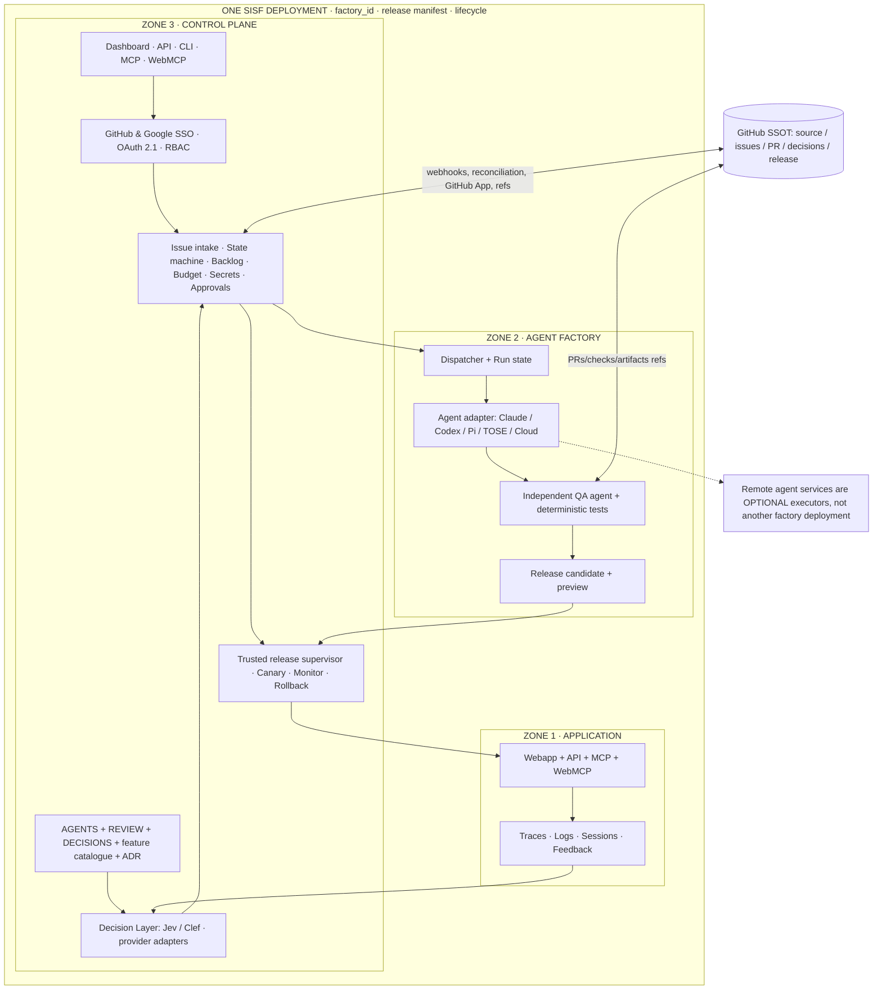
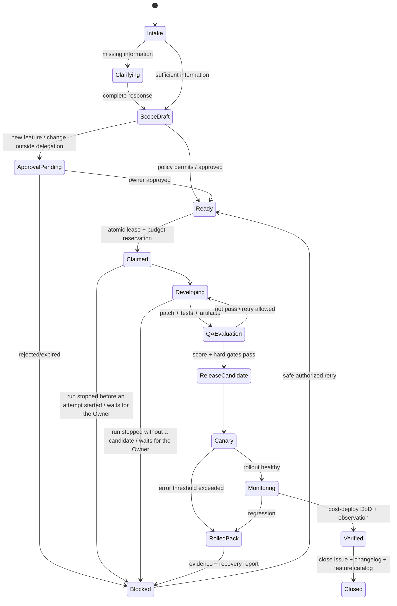

# Self-improvement Software Factory (SISF)

> **Decision brief & implementation contract**  
> Date: 2026-11-10 · Status: **Product decisions fixed; implemented in this repository** (what is proven: [README](../README.md#status) and the [acceptance matrix](acceptance-matrix.md))  
> Origin: `saasvn/tose-app`, HHP decision #574, and the architecture sketch provided by the Owner.  
> Purpose: to be handed to a coding agent in a **fresh context** so it can implement the system slice by slice, with verification at each slice.  
> Do **not** treat this document as authority to change production or to widen an agent's permissions.
> Vietnamese original: [self-improvement-software-factory-decision-brief.md](self-improvement-software-factory-decision-brief.md). The Vietnamese version is authoritative if the two differ.

## 0. Summary of decisions that must not be changed

1. **Product name:** `Self-improvement Software Factory` (SISF), an open-source framework. It is a closed-loop *software factory* that runs from request intake through publishing, monitoring, recovery and self-improvement of the system itself.
2. **Architectural invariant:** Zone 1 (Application), Zone 2 (Agent factory) and Zone 3 (Control plane) **must all live in one factory deployment**; they may use multiple processes/containers/services but share one `factory_id`, release manifest, configuration lifecycle, gateway and authority plane. They are not split into three products or three independent deployments. An external cloud agent is only an **execution backend** called by Zone 2, not a replacement for Zone 2.
3. **Zone 1:** the user-facing application with Webapp, API, MCP and WebMCP; it produces logs, traces, sessions, activities and feedback.
4. **Zone 2:** has built-in runtimes for Claude CLI, Codex CLI/app-server and Pi; it allows adapters to Claude Routines/Claude Cloud, Codex managed/cloud APIs and TOSE Cloud Agents, provided that the API, access permissions and a compatible lifecycle have been verified. The dispatcher, state/worker control and QA orchestration must be **inside the factory deployment**.
5. **Zone 3:** the control plane owns the dashboard, API, CLI, MCP, WebMCP, authentication, RBAC, graph dashboard, state graph, statuses, backlogs, approvals, traces/logs/activities/sessions, secrets, budget, feature catalogue, ADRs, docs/changelog and release/rollback.
6. **GitHub SSOT:** Git is the authoritative location for source/manifest/docs/ADR/decision policy; Issues/PRs/checks/releases represent work, evidence and decisions. Webhooks emit events. **GitHub is not used as a substitute transactional DB for locks, jobs, ledger, sessions/secrets**; the operational tables are derived/working state and always reference a SHA/issue ID/decision revision.
7. **Philosophical foundation:** `AGENTS.md`, `REVIEW.md`, `DECISIONS.md` (prioritization rules and questions for System One), `FEATURES.md` or `features.yaml`, `docs/adr/` and the policies signed/confirmed by the Owner. They are used to explain why an improvement is needed and how it is evaluated. An agent cannot edit a rule in order to pass QA on its own.
8. **Self-deployment of Zone 1:** happens after an independent QA agent gives a passing score **and** the deterministic gates/rollback preflight pass; deployment follows policy A/B/C. There is a progressive rollout/canary or blue-green with monitoring and **automatic rollback when the error threshold is exceeded**; if the release cannot be observed/rolled back safely, it is not self-published.
9. **Self-improvement of the factory:** the factory can improve its own Zone 1/2/3 code; updates to the orchestration/QA/policy machinery belong to the *trusted control surface*, which requires special protection and an updater/supervisor mechanism that is left intact. A new candidate is not allowed to both modify the QA criteria and score itself.
10. **Authentication:** sign-in with GitHub or Google SSO. Both map to an internal actor/role; a GitHub App installation is a permission over a repo, which is **different** from a user's GitHub sign-in. Remote MCP uses an OAuth 2.1 mechanism that conforms to the specification; browser WebMCP has no permissions beyond those of the backend.
11. **Default budget:** `unlimited`, as requested by the Owner; the factory still meters, displays cost, raises alerts and allows a hard cap to be configured; this does not mean the provider API allows unlimited spending, and this value is never used to remove limits on security, concurrency, duration or number of attempts.
12. **New features and upstream contribution:** the Owner decides on new features, expansion of scope/permissions, significant policy changes and sending contributions to the upstream package. Within the delegated scope, an agent may improve existing functionality on its own. Improvements still belong to **one factory deployment** unless the Owner actively chooses to share them.

Each invariant above has an ADR in [docs/adr/](adr/) that records the context, the decision and its acceptance test: [0001](adr/0001-three-zones-one-deployment.md) (items 2 to 5), [0002](adr/0002-trust-roots-and-supervisor-boundary.md) (item 9, section 6.3), [0003](adr/0003-policy-precedence-and-foundation-files.md) (item 7), [0004](adr/0004-github-ssot-and-operational-state.md) (item 6), [0005](adr/0005-self-deploy-zone1-qa-and-rollback.md) (item 8), [0006](adr/0006-login-vs-repo-permission.md) (item 10), [0007](adr/0007-budget-default-unlimited.md) (item 11), [0008](adr/0008-owner-authority-features-upstream.md) (items 1 and 12). Section 11 inheritance is listed in [0009](adr/0009-tose-reuse-candidates-for-later-audit.md). The open points of section 15 are ADRs [0010](adr/0010-new-requirements-placement.md) to [0018](adr/0018-people-during-an-incident.md), all proposed.

## 0.1 Terminology

| Term | Meaning in this document |
|---|---|
| Owner | The person who owns a factory deployment; the only person allowed to expand permissions, approve new features and change policy. |
| SoW / DoD | Scope of Work and Definition of Done (measurable completion criteria) of a task. |
| LKG | Last Known Good: the most recent release verified to run well, used as the rollback target. |
| HHP | Hybrid Harness Platform, TOSE's internal design from which SISF inherits its ideas (section 16). |
| Policy A/B/C | Three delegation modes per deployment, inherited from HHP: **A** on demand (the agent runs only when a human starts it), **B** proactive proposal (the agent proposes, and a human grants permission before anything is modified or released), **C** bounded autonomy (changes that pass every deterministic gate do not need per-change technical approval). Publisher actions such as sending an upstream contribution always require a human. |
| Decision Layer | The Zone 3 component that turns telemetry signals and feedback into evidence-based proposals. It only recommends and classifies; it does not grant permissions. |
| System One | The decision-model layer that returns typed judgments instead of free text, called by the Decision Layer through an adapter. |
| Jev, Clef | Two System One model options for the Decision Layer's adapter; configurable and version-pinned. On an error, a timeout or an answer that violates the schema, it fails closed. |
| Trusted control surface | The supervisor, signing keys, policy enforcement, QA baseline and rollback rules: the part that a candidate is not allowed to modify by itself (section 6.3). |

## 1. Goals and anti-goals

### Goals

- A person with a GitHub repository installs **one SISF deployment containing all three zones** and gets a system that operates itself end-to-end; TOSE is not required.
- Both inputs are closed loops: (a) a GitHub issue carrying a valid label and (b) telemetry/feedback that the Decision Layer converts into an evidence-based issue/proposal.
- Every task has a versioned SoW/DoD, a separate agent worker and QA agent, and progress and approvals that are observable through UI/API/CLI/MCP/WebMCP.
- Zone 1 is published safely, re-measured after deployment and rolled back automatically; the factory has a path for upgrading itself with a trusted updater.
- Backends are replaceable, but there is no promise that every provider/platform has the same capabilities.

### Non-goals for the first release

- Multi-tenant SaaS, a marketplace, selling licenses, automatic upstream contribution, a general CI system replacing GitHub Actions, building our own Git server/OCI registry/identity provider, a complex distributed scheduler, or supporting every platform by name without having passed E2E.
- Opening new features on its own, or letting an outsider's issue escalate deployment permissions.
- Guaranteeing that 'unlimited' = cannot be charged by the provider.

## 2. Logical architecture: one deployment, three zones



**Shared deployment:** one `factory.yaml` is the manifest of **one factory deployment**, with a `factory_id`, the `application`, `agent` and `control` components, the storage, the trusted release supervisor and networking; the runtime may be multiple containers in the same Compose stack/Kubernetes release/Cloudflare app deployment, or multiple processes. A platform that cannot guarantee this contract is recorded as *unsupported full deployment*; Zone 2 or Zone 3 is not quietly turned into a mandatory external SaaS. The cloud agent API and GitHub are permitted **integrations**.

**Lifecycle:** initialize/pause/update/recover/uninstall operate at the level of the factory deployment, but each zone has its own process/health check; the release manifest pins all artifacts/digests and schema compatibility. When Zone 1 changes, Zone 2/3 are not reconfigured automatically unless that is necessary.

**SSOT/GitHub:** each zone has its source and decisions in GitHub, but that does not mean every request in Zone 1 must be synchronized with GitHub. If GitHub is unreachable, Zone 1 continues to serve the verified revision; ingestion/publish must stop or be queued safely.

## 3. Interface/plugin definitions

### 3.1 AgentBackend

Capabilities are declared before use:

`start(task, workspaceRef, scopes) -> runRef`, `status(runRef)`, `events(runRef,cursor)`, `cancel(runRef)`, `collectArtifacts(runRef)`; optionally `resume`, `checkpoint`, `usage`, `humanInput`, `sessionLink`, `webhooks`.

- Built-in: Claude CLI; Codex CLI/app-server; Pi RPC. The agent runs in a task workspace with filesystem/network/time limits.
- Remote: Claude Routines/Cloud, OpenAI Codex Agents API/Cloud once the protocol is confirmed, TOSE Cloud Agents. An adapter returns `NOT_SUPPORTED` when cancel/replay/usage is missing, and must not claim to have a hard budget if the provider cannot enforce one.
- Provider tokens/subscription tokens are not placed in logs or in the user's container; only scoped, short-lived credentials are used.
- **Orchestration and decision computation reside in Zone 2/3 of the same deployment**, even when the executing agent runs externally.

### 3.2 ExecutionBackend

`createSandbox`, `exec`, `files`, `snapshot`, `inspect`, `destroy`, `health`, `capabilities`. Local process (trusted single-user), Docker, Docker+gVisor, K8s, Cloudflare Sandbox, Vercel Sandbox, TOSE runtime, and other compatible backends. A *hosted provider* is not equated with an *isolation guarantee*. If the required isolation cannot be proven, untrusted code is not run in automatic mode.

### 3.3 DeploymentBackend

`stage(artifact)`, `preview`, `measure`, `promote`, `observedRevision`, `rollback`, `capabilities`. Support for at least **one safe version-switching method with a way back** is mandatory before self-publishing. Docker/Compose and Kubernetes come first; serverless adapters follow the capability matrix. A successful update API call is not used in place of an observed healthy release.

### 3.4 Identity, State, Secret, Telemetry, GitHub

- `IdentityProvider`: GitHub OIDC/OAuth login flow and Google OIDC; a separate *GitHub App installation* for repository permissions.
- `StateStore`: SQLite WAL for single-host; PostgreSQL for HA/multi-process; lock/lease/CAS, outbox, transactional budget. Migrations are versioned.
- `SecretProvider`: local encrypted-at-rest, env reference or cloud secret manager; plaintext secrets are never stored in GitHub.
- `TelemetryAdapter`: OpenTelemetry spans + normalized logs/metrics/events, privacy redaction, and the attributes `factory_id`, `deployment_id`, `zone`, `release_digest`, `run_id`, `issue_ref`.
- `GitHubAdapter`: signed webhooks, event dedup, polling/reconciliation, issues/comments/labels, PR/checks/releases, token rotation/revocation.

### 3.5 Model and effort selection

The model route of each run is chosen by **code** according to the step type, never by asking a model to choose. The configuration lives in `.sisf/factory.yaml`, is pinned to the policy SHA and is written to the run record.

- **Routing by kind of work (starting default):** classification, intake, labelling and extraction use the provider's smallest model; coding against a clear SoW uses a mid-tier model; migrations, large refactors, architecture planning and leading many workers use the strongest model. Read-only subagents (finding files, reading logs, summarizing) use a small model; code edits and judgment calls stay on the main model.
- **Escalation ladder when a run falls short, in this order:** (1) make sure the agent can verify its own work with a test, a build or a script; (2) raise effort one level; (3) move to a larger model, starting at a lower effort than the one just used.
- **Run cheap first, re-run the failures:** because the QA gate scores automatically, a run starts at low effort; only runs that fail QA are re-run at a higher level. Escalations are capped and count against the issue's budget.
- **Switch models only at a state boundary:** switching mid-run loses the prompt cache and may lose earlier reasoning. On a switch, the new run receives a structured summary (SoW, DoD, decisions, evidence), not the full history.
- **Build requests for the strictest model:** `AgentBackend` keeps history append-only, sends `tool_choice: auto` with strict tool schemas, reads content blocks by type and writes tool descriptions precisely enough for the most literal model. A step can then change tier without a code change.
- **No advisor or multi-model setup by default:** a multi-model configuration is kept only when measurements on real work show it beats every single-model configuration on score against cost (see Value metrics, section 13).

The routing table is a calibration parameter, not a fixed decision; concrete model names belong to each deployment's configuration.

## 4. Evidence-based decision rules

### 4.1 Foundation files

| File | Responsibility | Automatic editing? |
|---|---|---|
| `AGENTS.md` | Product context, ways of working, technical principles for agents | May propose a PR; has no authority to change policy |
| `REVIEW.md` | QA/release criteria, mandatory evidence, review checklist | PR with Owner approval; agents do not lower thresholds on their own |
| `DECISIONS.md` | Philosophy, goals, no-gos, and the classification/prioritization method of the Decision Layer/System One | PR with Owner approval; always pinned to a SHA and schema version |
| `FEATURES.md` or `features.yaml` | Functionality approved by a human; behavior definitions/limits | Every new feature must have Owner approval |
| `docs/adr/*.md` | Architectural constraints and the rationale for decisions | Has history and Owner review when a decision is changed |
| `.sisf/factory.yaml` | Declares the 3 zones, adapters, desired-state configuration, release policy | Owner/Git branch protection; actual costs are not kept in the file |

**Order of precedence:** safety invariants in code + verified delegated authority > owner-approved policy/config at a protected SHA > `DECISIONS.md` / `REVIEW.md` / `FEATURES.md` / ADR > the execution guidance in `AGENTS.md` > issue/comments/logs. A conflict or an unapproved SHA => hold; the model is not allowed to pick whichever rule is more convenient.

**Note:** Markdown text can guide the model but does not replace deterministic checks. Clauses that need to be enforced must have a corresponding structured schema/test. Each decision stores `policy_sha`, `review_sha`, `decision_sha`, `feature_catalog_sha`, `model_route` and evidence IDs for audit.

### 4.2 Decision Layer contract

Flow: `signal → data quality + redaction → baseline / affected feature → candidate goal → typed questions → rationale + evidence → scope & policy check → task proposal`.

- Evidence consists of the metric, trend/baseline, sample count, time range, issue/session correlation, user impact, recurrence, confidence level and source refs. When there is not enough data, it chooses `collect_more_evidence` or `ignore`; it does not force an improvement into existence.
- The Analysis Agent produces the goal, the options, a draft SoW and a measurable DoD. Jev/Clef selects `ignore|observe|investigate|propose|implement|stop`, `bug|existing_improvement|new_feature|policy_change`, the priority and the points of uncertainty.
- `DECISIONS.md` defines the typed questions for System One and the weights/priorities; the model has no authority to modify scope, test evidence, release thresholds or budget.
- Model classification only **raises the level of caution** or the priority; deterministic checks have veto power.

## 5. GitHub issue workflow (mandatory)

### 5.1 Inputs and labels

- `sisf:ready`: an intake request; it does not by default grant execution permission. A configurable mapping from an existing label (for example `ai-handle`) may be allowed, and is **off** by default.
- `kind:bug`, `kind:improvement`, `kind:feature`, `kind:question`.
- `sisf:needs-info`, `sisf:approved`, `sisf:running`, `sisf:qa`, `sisf:canary`, `sisf:blocked`, `sisf:verified`; the framework updates the status labels, and labels are not used as a distributed lock.
- `agent:*` is a routing preference; the person applying a label does not thereby create permissions or budget. `deployment:<id>` must be validated against the repo/installation mapping.

### 5.2 State machine



- Every state is written to the operational DB with `version`, `idempotency_key`, `lease_owner`, `attempt`, `run_id` and `issue_id`, and is then projected onto GitHub. Webhooks are not assumed to be delivered in order or exactly once.
- GitHub webhook: verify the HMAC secret, action/type, install/repo and delivery ID; store an inbox transaction, return 2xx quickly, process asynchronously, and periodically reconcile and redeliver to the extent possible. Label/comment edits made by the bot itself must be protected against loops.
- The AI asks clarifying questions through comments; an issue with no response within the timeout moves to `needs-info` and does not spend money indefinitely.
- The SoW/DoD is versioned and attached to the issue/PR; a significant edit after approval invalidates the earlier approval.
- Progress: a single updatable summary comment, checkpoints/PR links, and live status in the dashboard; avoid spamming every log/token into the issue.
- `close issue` happens only after the **observed deployed version** meets the DoD and passes the monitor/rollback window. A PR merge does not automatically mean completion.

### 5.3 Feedback/feature flow through MCP/API/UI/WebMCP

`report / propose → triage / interview → classification → SoW/DoD → create issue → pass approval according to type → run the pipeline above`. For a new feature: the **Owner explicitly approves the scope** before coding/production. The person submitting a report does not become the Owner.

### 5.4 Approval inbox

Every protocol has the same `list approvals`, `get proposal + evidence + diff + affected features`, `approve/reject/request-changes` and `status/audit`. An approval is accepted only from an authorized actor, is based on `subject_digest`, policy revision, expiry and nonce, and cannot be replayed; sensitive actions require step-up/verified user confirmation, and **a browser agent is not allowed to use an ambient Owner session to impersonate the approver**. With CLI/MCP, a device/browser verification flow can be started and the result is then received through that same protocol.

## 6. QA, self-publishing, self-rollback

### 6.1 Independent QA

- The coding agent has a different identity/workspace from the QA agent. When the deployment has two or more model routes, QA must use a different model or provider from the coding agent to avoid shared blind spots; if there is only one route, the receipt records `same_model_route: true` and the policy may require Owner approval instead of self-publishing. QA has a **read-only** test baseline, locked to the commit and policy SHA, and runs the deterministic suite + threat negative tests; it may use a judge model for semantic criteria.
- **Starting rubric, to be calibrated:** correctness/regression 30, security + auth 25, contract + data safety 20, UX/performance/output 15, observability + rollback 10. The default proposal is `score >= 85/100` with not a single hard-gate failure; this number is a **design starting point**, not a threshold proven by research.
- *Hard gates:* tests/contract, permissions, migrations, secrets, confidence of observed build, independent evaluator, resource/budget policy, rollback readiness. A high QA score must not override a hard failure.
- A `qa_receipt` signed by the trusted evaluator is recorded: candidate digest, suite digest, baseline SHA, QA agent identity, the `model_route` of both the coding agent and the QA agent, checks, score, timestamp, expires, evaluator attempt.
- QA cannot score code that has not finished building, nor borrow the receipt of a different commit.

### 6.2 Release pipeline

`build immutable candidate → preview → QA → preflight rollback → canary OR blue-green → observed revision + metrics → promote/restore`.

- It is acceptable to start with **blue-green + smoke + monitor**; when the environment supports canary traffic, `5%→25%→100%` is the **proposed default, which must be calibrated**, and must not be forced onto a platform that has no traffic split.
- Auto rollback occurs when a metric exceeds `rollback_error_rate` after `min_sample_count` within `window` and exceeds the baseline significantly; an illustrative configuration: 5xx > 2% and an increase of > 1 percentage point over baseline, `min_samples=100`, `window=10m`, 2 consecutive windows. All of these are *starting* parameters that need to be evaluated on real traffic; a critical security/health failure triggers a rollback or an immediate stop. With low traffic, no conclusion is drawn from 1 failed request; smoke/synthetic + hold is used.
- **Low-traffic mode:** when real traffic does not reach `min_sample_count` within `window`, the release switches to evaluation by mandatory synthetic checks. The synthetic suite must cover the flows listed in the DoD and run repeatedly throughout `low_traffic.min_hold` (for example, a starting value of 30 minutes, to be calibrated). It passes when every synthetic run passes, the health check is stable and there are no new critical-level errors in the logs. An error from a real request during the hold does not automatically trigger a rollback, but it extends the hold and is recorded in the evidence. An app without a synthetic suite is not allowed to self-publish in this mode.
- When metrics are missing/there is no recovery version/the deployment adapter is broken: `pause/hold`; success is not assumed.
- Rollback only replaces compatible code/config; it does not overwrite customer data with an old snapshot on its own. Backward-compatible versioned storage migrations or Owner approval are required.
- The release monitor must not have its QA baseline updated by the very version under test.

### 6.3 The ability to improve the factory itself

- The factory source includes the code of all three zones, which allows working on tickets/fixing bugs in Zone 2/3; self-improvement is **not** limited to the user's Webapp.
- The trusted release supervisor in Zone 3 is a small, separate and pinned process/image that keeps the LKG outside the candidate's modifiable area, but it **still belongs to one factory deployment**. No service outside the factory is needed to rescue the factory.
- **Supervisor boundary:** "same deployment" means that the supervisor is declared in the same `factory.yaml` and shares the `factory_id` and the install/uninstall lifecycle. "Outside the candidate's modifiable area" means that all four of the following are true: (1) the supervisor runs from its own digest-pinned image and is not built from the same artifact as the candidate; (2) the LKG, signing keys and rollback configuration reside on a volume or store to which the Zone 1/2 processes and every agent workspace have no write access; (3) the normal release pipeline has no permission to change the supervisor's digest, and only a governance cycle with human approval can do so; (4) the supervisor checks its own digest at startup and refuses to run if it deviates from the signed manifest. The P0 conformance checker verifies all four; if any one is missing, self-update is disabled.
- Within a single self-upgrade pass, the candidate must not simultaneously change the trusted supervisor, signing keys, policy enforcement, QA baseline or rollback rules. Those changes are a **governance change with human approval**, and go through a separate update cycle.
- The DoD must include a trial update of a non-sensitive part of Zone 3 (for example a read-only dashboard page), self-monitoring and auto-recovery; it must prove that Zone 1 keeps serving while Zone 2/3 restart.

## 7. Authentication, authorization and secrets

- GitHub: login through GitHub OAuth/GitHub App user auth; repo permissions through a minimal **installation token**, and login is not conflated with repo permissions. Google SSO uses an OIDC ID token, identifies by `issuer+sub`, and validates signature/iss/aud/exp/nonce; identity is not established by email alone.
- Workspace roles: Owner, Maintainer, Reporter, Viewer, Agent, QA, Publisher/Deployment service. They map GitHub membership + locally granted roles, are checked at the time of the action, and issue labels are not used as roles.
- User-session API: HttpOnly/SameSite session cookie + CSRF for the browser; short-lived personal access/service tokens with scopes for API/CLI.
- Remote MCP: OAuth 2.1 + Protected Resource Metadata + resource-bound scopes, issuer/audience validation. WebMCP: only when the browser supports it, bound to the existing session and sharing the backend auth; when it is not supported, there must be an API/MCP/UI fallback.
- Secrets: stored encrypted, not sent into issues/PRs, and an agent running on untrusted code is not allowed to read the GitHub App/Owner token. A per-run secret broker limits purpose/scope/TTL and revokes on cancel.
- A sensitive approval is signed, single-use, subject/release/policy-bound and expiring; who performed it (human or agent) is audited.

### Additional security requirements

The requirements below add to the rules above and in section 6.3; they replace none of them. Requirements 1 to 3 decide how much harm a manipulated agent can do, so they must exist before the factory runs untrusted code (P1 to P2); the rest attach to P2 to P3. They are not yet assigned to the DoD of any phase and have no acceptance tests of their own in section 13.

1. **Agent egress.** The egress policy is the Owner's decision and can be changed through every surface (Dashboard, API, CLI, MCP, WebMCP); each change goes through `plan -> approval -> execute -> audit`, and an agent cannot widen the policy for itself. The default is an allowlist of common domains sufficient for development: the configured model providers, GitHub, package registries (npm, PyPI, crates.io, Go proxy, Maven Central), image registries (Docker Hub, GHCR) and operating-system package repositories; other domains are blocked and logged so the Owner can review and add them. The Owner can narrow, widen or turn off blocking; widening and turning off show a risk warning. An `ExecutionBackend` publishes its ability to enforce egress policy in `capabilities`; for a backend that cannot enforce it, the rule in section 3.2 applies to untrusted code.
2. **Isolation between the three zones.** Each zone has its own credentials, network segment and state-store permissions. Zone 1 has no write path into Zone 3 and cannot read the secrets of Zone 2 or Zone 3; Zone 2 calls Zone 3 only through the authenticated API. The conformance checker verifies these boundaries.
3. **Supply chain.** A change to dependencies, lockfiles, base images or CI configuration is a hard gate of its own: versions must be pinned and pass vulnerability scanning, and a new dependency needs Owner approval. Every release has an SBOM, provenance and signed artifacts; the trusted release supervisor rejects an artifact whose signature cannot be verified.
4. **Operational data is untrusted data.** Telemetry, feedback, report content and PRs from outside are handled like issues/comments/logs: data only, never instructions. The Decision Layer does not widen permissions or change policy on the basis of these sources. The public report endpoint has a rate limit, a size limit and deduplication. Accepting outside PRs follows the access of the GitHub repo: a public repo accepts PRs from forks but treats them as untrusted input (run in a sandbox with no secrets and no write access to the repo, and a Maintainer must accept them before they enter the pipeline); a private repo accepts PRs only from collaborators and the factory's agents.
5. **Signing-key management.** The root key is held by the Owner outside the factory (KMS, HSM or a hardware key). The factory holds only short-lived signing keys delegated from the root key, stored in the Zone 3 secret store and usable only by the trusted release supervisor and the approval service; agents and candidates cannot read any key. If Zone 3 is compromised, the Owner revokes the delegated keys without replacing the root key. The local native profile may keep the root key in the Zone 3 secret store and must clearly display this lower level of assurance. The rotation period and revocation procedure are documented; the webhook secret can be rotated without losing events.
6. **Tamper-evident audit log.** The audit log is append-only and hash-chained (or copied to storage outside the factory), so that deleting or editing a record is detected. No role in the factory, the Owner included, can edit a written record.
7. **Sensitive data in telemetry and transcripts.** Secrets and personal data are redacted before being written to logs, agent transcripts, issues and PRs. Each kind of data has a retention period. Policy states which data may be sent to remote agents and model providers.
8. **Kill switch and threat model.** The Owner has one emergency-stop command: stop claiming tasks, cancel running runs, revoke per-run secrets and freeze publishing; it does not depend on the part of the factory that may have been compromised. P0 creates `docs/threat-model.md` listing assets, trust boundaries and abuse scenarios; every high-severity scenario has an acceptance test.

## 8. Budget and cost

- The default is **`budget.mode: unlimited`**, still with a usage ledger, dashboard expense/retry alerts, per-provider key controls and cancel. `unlimited` means that no *monetary limit set by SISF itself* is applied; it is not a commitment to unlimited actual spending or to the use of a free provider.
- **Safety on a fresh install:** the installer clearly displays the `unlimited` default and requires the Owner to confirm once, and at the same time to set `budget.alert_threshold` or explicitly choose not to set it. Until that is confirmed, the factory only accepts intake and does not claim tasks. When the alert threshold is exceeded, it sends a notification and does not stop on its own unless the Owner has chosen `capped`.
- The factory owner can choose `budget.mode: capped`, a spending-period reset/one-time, and a rollback reserve. Costs are synchronized through the provider adapter; discrepancies/usage not yet measured are shown as `unverified`, and the guarantee is not overstated.
- Even with unlimited money, every task has a timeout, max attempts, concurrency, cancellation, rate limit and resource quotas to prevent loops. Roles/scopes are not escalated automatically.
- When the user sets a hard cap, a reservation is made before starting; side effects must be idempotent, and costs that exceed the estimate are reflected/suspended. A local factory cannot enforce limits on a model provider if the provider has no hard limit: the level of guarantee is reported openly.

## 9. Dashboard and tool interfaces

### Minimum pages

- **Overview:** health of the three zones, running revision, canary strategy, error rate, throughput, cost, stop/rollback button.
- **Workboard:** backlog/issue list, status and owner/agent, SLA/age, live progress, retry, session link.
- **Run graph:** DAG/state graph for each task, timing, tool events, decision receipts and QA evidence.
- **Telemetry:** filtered traces/logs/activities/sessions, searchable by release, issue, run, feature.
- **Approvals:** request, impact, diff, SoW/DoD, decision, reason, audit.
- **Product:** feature catalogue, changelog, docs/guides, ADR, DECISIONS.md history.
- **Security & finance:** user roles, agent capabilities, secret refs, budget unlimited/capped, usage breakdown, SSO/GitHub App installations.

### One service layer, many protocols

- REST/OpenAPI is the internal backend contract; the CLI, Dashboard, MCP and WebMCP call the same policy/action service and do not define independent permissions of their own.
- Queries: `factory.status`, `issues.list`, `runs.inspect`, `approvals.list`, `approvals.decide`, `secrets.list_refs`, `budget.get/set`, `decisions.propose_update`, `docs.list`, `features.list`, `changelog.list`, `deployments.rollback` (with different scopes).
- Sensitive writes go through `plan -> approval -> execute -> audit`, with human reauthentication/step-up according to the type of permission; **permission is not granted through a tool description**.
- WebMCP is an optional client-side tool surface and does not replace remote MCP; the plan supports browser feature detection and a fallback.

### Experience requirements: agents, users, developers

The requirements below apply when the corresponding surface is built (P1 to P3) and do not widen the permissions of any surface.

**Agents using the factory (AX)**

- Every action returns typed error codes and `next_actions`, so an agent knows the next valid step without guessing.
- Every write supports `dry_run`, returning exactly what would change; sensitive writes still go through `plan -> approval -> execute -> audit`.
- A `runs.explain` action answers why a run is stopped or blocked, with evidence and the current state.
- `llms.txt` and the action schemas are generated from the same source as the OpenAPI document.

**Owner and Reporter (UX)**

- The approval inbox shows a one-sentence risk summary, the expected diff and the affected features, and allows conditional approval (budget cap, expiry).
- Each issue has a single progress comment that is updated in place; the system does not post a new comment for every state change.
- First-time setup is a wizard that checks each step (GitHub App, SSO, budget) and ends with a sample issue running the full lifecycle.
- The `Blocked` state has an explanation page written for people, with the next action.

**Installers and plugin authors (DX)**

- `sisf doctor` checks all three zones, GitHub permissions, the state store and rollback readiness before a real run.
- A conformance test suite is packaged per interface in section 3, so backend authors can grade themselves.
- A local simulation mode with a fake GitHub and a fake agent runs the full issue lifecycle without spending tokens.
- `.sisf/factory.yaml` has a published JSON Schema so editors can suggest and flag errors early.

## 10. Deployment portability: compliance classes

**Invariant:** no platform adapter may arbitrarily split one SISF deployment into three independent application deployments; they must share the factory release manifest and lifecycle. Outsourced infrastructure services (GitHub, IdP, DB/object store, remote coding backend) are dependencies, not a new zone.

| Profile | Packaging | Support conclusion |
|---|---|---|
| local native | app + dispatcher/worker + control plane in one supervised local install, SQLite state | MVP; use only trusted code if a sandbox is missing |
| Docker Compose | one compose project, zone services in separate containers + DB/volume, pinned image digests | **Mandatory MVP**; gVisor optional when the host supports it |
| Kubernetes | one Helm release/namespace ownership, app/development runner/control + persistent store/rollback | next phase; security E2E mandatory |
| TOSE | one factory deployment with TOSE storage/runtime/budget adapters | next phase, not a mandatory dependency |
| Cloudflare | Workers + container/sandbox/DO bindings under one factory application deployment containing all zones | marked as passing only after E2E; Workers alone do not replace a shell runner |
| Vercel | App/API + agent dispatcher/job control + Vercel Sandbox and persistent state in the same logical factory installation | marked as passing only after E2E and timeout/recovery proof |
| Render / Railway | service group/containers + persistent state under one factory installation manifest | after E2E; sandbox hardening is not assumed by default |

If a provider cannot satisfy `single_factory_deployment`, `durable_tasks`, `safe_exec`, `releasable_zone1` and `rollback`, the profile is in the **experimental/unsupported** state, and “deploy anywhere” with full capability is not written.

### Deployment design: runtime units

One factory deployment consists of nine runtime units. Unit names are the same on every platform; only the realization (process, container, pod, function) changes. The release manifest pins the digest of every unit.

| Unit | Zone | Lifecycle | Role and constraints |
|---|---|---|---|
| `app` | 1 | long-running, with stable and canary revisions | Serves user traffic; scales horizontally. |
| `control` | 3 | long-running | Dashboard, API, MCP, webhook receiver. Not public by default, except the webhook route and the report endpoint. |
| `supervisor` | 3 | long-running, a separate process from `control` | Trusted release supervisor. The only unit that holds deploy rights and the delegated signing keys. |
| `dispatcher` | 2 | long-running, one instance holding a lease | Claims tasks, keeps run state, creates and destroys runners. |
| `runner` | 2 | ephemeral, one per run | Runs the coding agent. Accepts no inbound connections, egress by policy, holds only that run's secrets. |
| `qa-runner` | 2 | ephemeral | Runs independent QA with an identity and credentials different from `runner`. |
| `state` | shared | durable | SQLite WAL or PostgreSQL; one role per zone. |
| `artifacts` | shared | durable | Volume or object store for artifacts, logs and snapshots. |
| `edge` | shared | long-running | Reverse proxy and TLS; splits traffic between stable and canary. |

The network is divided into four segments: `app`, `factory`, `control` and `sandbox`. Runners live in `sandbox` and reach the outside only through an egress proxy that enforces the policy in section 7.

### Operating modes

The table below is the target design of each mode; support status still follows the compliance table above and is raised only after E2E. Third-party platform service names must be re-verified against current documentation when the adapter is written.

| Mode | `app`, `control`, `supervisor`, `dispatcher` | `runner`, `qa-runner` | `state`, `artifacts` | `edge` and access |
|---|---|---|---|---|
| Standalone | Processes on one machine, supervised by `sisf` through systemd or launchd | Local process (trusted code only), or a container if the machine has Docker | SQLite WAL and a local directory | Direct, Tailscale or a tunnel (see below) |
| Docker | One compose project (stack), one service per unit, images pinned by digest | Ephemeral containers on the `sandbox` network, created through an API-restricted socket proxy; gVisor optional | PostgreSQL and named volumes | A reverse-proxy service in the stack |
| Kubernetes | One Helm release in one namespace; one Deployment per unit; canary is a second weighted Deployment | Jobs, one pod per run; ServiceAccount with no mounted token, default-deny NetworkPolicy, an isolating RuntimeClass if the cluster has one | StatefulSet or external PostgreSQL; PVC or object store | Ingress or Gateway |
| Vercel | `app` and `control` are function projects; `dispatcher` and `supervisor` are durable workflows or queues, because there is no always-on process | Vercel Sandbox | External PostgreSQL and object store | Platform edge; canary through percentage-based releases |
| Cloudflare | `app` and `control` are Workers; `dispatcher` and `supervisor` are Durable Objects or Workflows | The platform's containers or Sandbox | D1 or external PostgreSQL; R2 | Platform edge; canary through gradual deployments |
| TOSE (tose.sh, `saasvn/tose-app`) | Apps in one workspace, built from Git, with domains and TLS | TOSE runtime through `ExecutionBackend` | Managed database with a persistent disk | Platform domain |
| Railway | Services in one project, connected over the private network | Remote executor, or trusted code only, because the platform has no nested sandbox | Platform PostgreSQL and volumes | Platform domain |

**Standalone has three access paths.** Direct: `control` listens on localhost only, or sits behind a TLS reverse proxy when exposed to a network. Tailscale: `control` listens only inside the tailnet; the tailnet's device identity is an additional layer and does not replace SSO or RBAC. Tunnel: only `app` and the webhook route are exposed. GitHub webhooks need a public endpoint; without one, the factory runs in polling plus reconciliation mode and publishes that delay.

**Constraints per mode.**

- Docker: do not mount the Docker socket directly into `dispatcher`, because the socket equals root on the host. Use a socket proxy that only allows creating and destroying containers on the `sandbox` network, or rootless Docker.
- Kubernetes: `supervisor` has RBAC only inside the factory's namespace. The factory does not need cluster-admin.
- Vercel and Cloudflare: functions have execution time limits, so each run is split into checkpointed steps that can resume after an interruption.
- Prepaid platforms: the adapter checks that the balance covers one rollback before publishing; if it does not, the issue stays in `Releasing`.
- Every mode: if `supervisor` cannot be separated from the candidate (same process, same credentials), that mode must not self-publish.

## 11. Recommended repository layout

```text
sisf/                                      # OSS repo: github.com/bestagentkits/sisf
  cmd/sisf/                                # CLI
  cmd/factoryd/                           # Zone 3 server, dispatcher
  internal/ or pkg/core/                  # clean policy & decision contracts, no TOSE imports
  pkg/identity/ pkg/state/ pkg/github/
  pkg/agent/ pkg/execution/ pkg/deploy/
  pkg/qa/ pkg/telemetry/ pkg/approvals/
  adapters/agent/{claude,codex,pi,tose,claude-cloud,codex-cloud}/
  adapters/exec/{local,docker,kubernetes,cloudflare,vercel,tose}/
  adapters/deploy/{compose,kubernetes,tose,cloudflare,vercel,render,railway}/
  ui/                                      # Dashboard + optional WebMCP
  templates/                               # three-zone full deployment manifests
  examples/                                # hello-app, app-with-existing-repo
  docs/adr/ docs/guides/ docs/security/
  .sisf/                                   # example instance policy/config
  AGENTS.md REVIEW.md DECISIONS.md FEATURES.md
  LICENSE NOTICE SECURITY.md CONTRIBUTING.md
```

**Inheritance:** the reuse candidates from `saasvn/tose-app/internal/harnessplatform` are `delegation`, `decision`, `scope`, `budget`, `promotion` and `upstream`. `tose-v2/internal/policy` and the TOSE OAuth/wallet/K8s bindings must be removed, and provenance/license must be verified before going public. `internal/services/piadapter` is currently tightly coupled to K8s/agentsec; only the contract and the protocol adapter part are reused, and the whole TOSE agent service is not carried over to OSS. Current TOSE operations are kept unchanged during the extraction.

**License:** Apache-2.0, finalized by the Owner on 2026-11-10 (`LICENSE` and `NOTICE`, copyright AgentKit.best). This license applies to newly written code and documentation in the repo; code extracted from TOSE may be included only after an audit of provenance and dependencies, and this document does not by itself license the old source code.

## 12. SoW and implementation order (fixed scope for the coding agent)

### P0: ADRs + invariant architecture + survey of reuse rights

**In scope:** split the invariants in section 0 into separate ADRs in `docs/adr/` (three-zones-one-deployment, trust roots and the supervisor boundary, policy precedence, GitHub SSOT) and have this document point to them instead of repeating them; maintain the English version of the brief in parallel with the Vietnamese version; license/provenance; interface contracts; single-deployment test scenarios; marking up the adapter capability matrix.

**DoD:** documentation + tests/conformance checker that reject a configuration missing a zone or a supervisor that does not meet the boundary in section 6.3; each invariant in section 0 has an ADR; the EN and VI versions of the brief match; factory identity/runtime IDs can be separated; production TOSE is not changed; the owner approves API/format changes.

### P1: Running three-zone local/Compose build + GitHub workflow

**In scope:** one manifest that brings up a sample Zone 1 application + the Zone 2 dispatcher/agent + the Zone 3 control plane, SQLite durable state, GitHub App/webhook/poll, receiving issues and synchronizing state, SoW/DoD/clarify comment, worker lease/idempotency, a minimal dashboard, stop/restart.

**DoD:** installs from a fresh clone with a single entrypoint; health covers all 3 zones; a labeled issue goes through clarification to claimed, and duplicate/reordered webhooks do not cause duplicate runs; killing the worker and restarting still resumes/reconciles; the browser and the API show the same state.

### P2: Built-in agents + QA + release with rollback

**In scope:** the first two real built-in agent adapters, proposed to be Claude CLI and Codex; Pi is the third built-in adapter before v1 is declared complete; independent QA, baseline & typed QA receipts, preview, blue-green or canary, observed revision, metrics threshold, automatic rollback, issue close after verification; proof that the factory updates a non-sensitive part of Zone 3 by itself; **a thin slice of the Decision Layer**: one real type of Zone 1 telemetry signal (for example error rate per endpoint) goes through the entire flow in section 4.2 and produces a proposal with evidence; Jev/Clef is not needed yet, and classification by deterministic rules is sufficient.

**DoD:** agent A makes the patch, agent B does QA, the score and hard gates are verified, Zone 1 is deployed, an injected fault causes an automatic rollback, and the issue is reopened/blocked with evidence; one factory self-update and rollback are tested on the same deployment; a telemetry signal with enough samples creates exactly one proposal with evidence, and a signal with insufficient samples yields `ignore` or `collect_more_evidence` and creates no issue.

### P3: Complete auth/surfaces/Decision Layer/observability

**In scope:** GitHub/Google SSO; role/grant; the full dashboard; API/OpenAPI, CLI, remote MCP OAuth 2.1, feature-detected WebMCP; `DECISIONS.md` with the typed model adapter Jev/Clef, extending P2's Decision Layer slice into full telemetry-driven goal proposals, feature catalog/changelog/docs/ADR, cross-surface approvals, secrets, budgets with default unlimited and optional capped.

**DoD:** the same permissions and behavior on 5 surfaces; login with 2 IdPs and cross-role/cross-repo tests; the Decision Layer produces proposals with supporting evidence and chooses do-nothing when evidence is lacking; the Owner approves a feature from any surface but the final human verification cannot be bypassed by an agent; budget is measured and stop is honored.

### P4: Remote agents + portability/benchmark + OSS release

**In scope:** Pi (if not done yet), Claude Cloud/Routines, Codex managed Agents API/Cloud, TOSE Cloud Agents behind feature flags; provider capability validation, then Kubernetes, TOSE and serverless platforms in turn; threat review, performance, privacy, licensing, documentation, example recipes.

**DoD:** at least 2 independent full deployment environments (Compose + one other platform), 2 different agents handling the same contract, and a failed/slow/unavailable provider does not cause the factory to mark success; a public conformance matrix; EN/VI guides exist; a GO/MODIFY/STOP decision based on data.

### Out of scope for v1 even though on the roadmap

- Claiming full support for all hosts before E2E.
- Self-releasing a version that modifies the trust root, auth provider, policy evaluator or rollback supervisor without human approval.
- Public multi-tenant billing/marketplace, or a network Git server replacing GitHub.

### Proposal awaiting Owner approval: v1 delivery order

> **Not yet in effect.** This section does not change any decision in section 0, and the coding agent must not treat it as approved scope. It only proposes changing the **delivery order**; it does not drop features.

- **Proposal:** call P0–P2 v1 and release publicly right after P2, with Docker Compose, the CLI and a read-only dashboard. Remote MCP, WebMCP, Google SSO and the serverless profiles remain product decisions, but are delivered after v1 according to P3–P4.
- **Rationale:** P3 currently bundles 5 surfaces, 2 IdPs, the full Decision Layer, secrets and budgets, which is equivalent to a separate product. Releasing after P2 makes it possible to measure the value metrics in section 13 on real users before investing in the rest.
- **Trade-off:** v1 has only GitHub sign-in and cannot yet be controlled through MCP; anyone who needs Google SSO or remotely controlled agents has to wait.
- **How to approve:** the Owner approves by means of an ADR; at that point this section becomes official scope and P4 is no longer a precondition of the first OSS release.

## 13. Overall system DoD (acceptance matrix)

| ID | Repeatable test | Pass criteria |
|---|---|---|
| SISF-01 | Fresh install Local/Compose | Exactly 1 `factory_id`, with Zone 1/2/3 all in the same deployment manifest and sharing a lifecycle |
| SISF-02 | Issue with a valid label | Intake → clarification comment → versioned SoW/DoD → claim → coding → independent QA → deploy → verify → close; every milestone appears on GitHub and in the UI |
| SISF-03 | Issue from a user without permission / unapproved feature | No deployment/permission expansion; the new feature goes into the approval inbox and requires an Owner decision |
| SISF-04 | Two duplicate webhook events + reorder | Exactly 1 run has the right to claim, with no duplicate spending; reconciliation recovers missed events |
| SISF-05 | Worker dies mid-task | Recovers from state/lease; fencing blocks stale reports; no saved SoW, PR or artifact is lost |
| SISF-06 | QA agent scores its own patch | Rejected; the QA receipt is pinned to the candidate SHA and an independent test baseline |
| SISF-07 | QA score passes but security/contract fails | No publish regardless of score |
| SISF-08 | QA passes + health is good | Zone 1 goes up at the correct digest; the observed revision is checked; the changelog/feature catalogue is updated with the correct permissions |
| SISF-09 | Error rate exceeds the threshold during canary/monitor | LKG is restored automatically; evidence is logged + the issue is not closed or is reopened; customer data is intact |
| SISF-10 | The factory fixes a non-sensitive part of Zone 3 by itself | QA + release/rollback within the same factory deployment, and the supervisor is not replaced by the candidate |
| SISF-11 | `DECISIONS.md` changed through an unapproved agent PR | The old policy baseline remains in effect; the Decision Layer has no authority to change the standard |
| SISF-12 | GitHub/Google SSO & OAuth | issuer/sub/audience, session, scopes, repo install mapping, approval step-up, revoke and CSRF negative tests pass |
| SISF-13 | API/CLI/MCP/WebMCP/Dashboard | Same action service, equivalent authorization; when WebMCP support is missing there is still a fallback |
| SISF-14 | Budget default unlimited/capped | Unlimited is an explicit default and the Owner confirmed it at install time; an alert fires when `alert_threshold` is exceeded; costs are recorded; capped reserves & stops, and a provider that does not support a hard cap is flagged |
| SISF-15 | Two factory deployments on the same upstream | A local improvement in A does not change B or upstream; a contribution requires the user to trigger it |
| SISF-16 | Running on a new backend | The conformance matrix covers lifecycle/isolation/rollback/observability; if anything is missing it is marked unsupported |
| SISF-17 | No-activity / no-benefit telemetry | Does not create issues indefinitely; there is an `ignore`/`observe`/`stop` consistent with the product philosophy |
| SISF-18 | Fresh agent with no chat history | Reads the policy + SoW/DoD + repo; reconstructs the context and completes the work without needing the old chat |
| SISF-19 | Secrets + a GitHub issue containing prompt injection | No privilege escalation, no token leak, no self-modification of QA/policy, no calls to forbidden egress domains |
| SISF-20 | Release lacking metrics or rollback capability | Hold/blocked; no self-publishing on a model that assumes success |

**Release GO** only when there is no unresolved High/Critical security issue, there is a real E2E report, and any part recorded as experimental is labeled honestly. **Stop/MODIFY** if a single 3-zone deployment cannot be proven, if the factory loses its ability to recover, if an agent grants itself permissions, if it closes an issue on its own before the DoD is met, or if it does not create more value than a simple GitHub+agents workflow.

### Value metrics

The condition "creates more value than a simple GitHub+agents workflow" is measured by running the same set of issues through two paths: SISF and a baseline consisting of GitHub Actions calling a coding agent, followed by a human reviewing and merging. Data is collected from P2 onward, on at least one real repo:

| Metric | How it is measured | SISF must be |
|---|---|---|
| Rate of issues completed without human intervention | Issues that reach `Verified` with no manual action other than mandatory approvals, divided by the total issues claimed | Higher than baseline |
| Change failure rate | Releases that are rolled back or issues that are reopened within the observation window, divided by total releases | Not higher than baseline |
| Time from issue to verified | Median from `Ready` to `Verified` | Not slower than baseline by more than the Owner accepts |
| Cost per verified issue | Model and infrastructure cost from the usage ledger, divided by the number of `Verified` issues | Reported; the Owner decides the acceptable level |
| Useful proposal rate | Decision Layer proposals approved by the Owner, divided by total proposals | Reported; too low is a STOP signal for the Decision Layer |
| Cost by model route | Cost per `Verified` issue broken down by the model and effort of each step, taken from the usage ledger | Reported; a multi-model configuration is kept only if it beats every single-model configuration |

The specific thresholds are set by the Owner once the first baseline data is available; the GO/MODIFY/STOP decision in P4 must cite these metrics.

## 14. Implementation instructions for the coding agent

1. **Do not reverse product invariants on your own**. If you find the 3 zones on 3 separate deployments, treat it as a design error; propose an alternative or fail the capability gate.
2. Start with a read-only review of the repo/ADRs and a dependency & license audit; confirm the source snapshot. Do not assume that the HHP pure policy core already has an API/worker that actually runs.
3. Build the **smallest vertical slice** and commit step by step; tests must be red before each behavior, with negative tests for security/spending.
4. Keep backward compatibility when extracting code from TOSE: move it behind an adapter, and do not modify TOSE production logic merely to make extraction convenient.
5. Each step returns: the work done, file changes/commits, test results, new risks, which DoD items are met/not met, and blockers. Do not claim to have deployed when there are only unit tests.
6. Do not create issues or add `ai-handle` unless separately authorized by the Owner. Do not touch production, do not rotate secrets and do not grant permissions on the basis of this document.
7. Before opening a PR, re-check the Owner-signed policy/manifest/DoD against the current commit; if there is a conflict, report it rather than amending the decision yourself.

## 15. Decisions already finalized and points requiring technical verification

### Finalized (do not re-interview)

- The name SISF, 3 zones in the same deployment, a flexible Zone2, GitHub SSOT, GitHub issue/telemetry input, SoW/DoD + QA + auto publish of Zone1 + rollback, dashboard/5 surfaces, GitHub/Google SSO, unlimited budget by default, the AGENTS/REVIEW/DECISIONS philosophy, self-improvement of itself, new features/contribution belong to the Owner.

### Default technical parameters for experimentation, **to be calibrated against benchmarks**

- A starting QA score of 85/100 **plus** hard gates; canary 5→25→100 when the platform supports it; an example error threshold of 5xx>2% and delta>1pp with enough samples. These are not applied mechanically to an app with no HTTP requests or with low traffic.
- Local SQLite WAL, multi-worker Postgres; Compose is the first full-deployment profile; the first 2 built-in agents are Claude CLI + Codex, followed by Pi. These may be replaced if a proof shows that another adapter is more feasible while still providing two backends.
- GitHub App OAuth for the repository workflow, Google OIDC for SSO, and role mapping that needs to be explicit. The OSS repo is `bestagentkits/sisf`, licensed Apache-2.0 (finalized); code inherited from TOSE must still pass an ownership audit before being included.

### Open points awaiting an Owner decision

> **Not in effect.** The points below are known gaps, not requirements. The coding agent does not decide them for the Owner; each is closed by an ADR that states it is either a requirement (with a phase and an acceptance test) or a deliberate non-goal.

1. **New requirements have no place in the SoW.** Section 3.5, the experience requirements in section 9, the additional security requirements in section 7 and the deployment design in section 10 are not assigned to the DoD of P0 to P4 and have no SISF-xx tests. To decide: which phase each requirement belongs to and which test proves it.
2. **v1 scope.** The delivery-order proposal in section 12 still awaits approval, while the scope has grown. To decide before P0 starts.
3. **Backup and restore.** There are no rules for backing up `state` and `artifacts`, RPO and RTO targets, or rebuilding the factory from GitHub when the database is lost.
4. **Schema migration when the factory updates itself.** Code rollback has rules; rollback after the database schema has changed does not. To decide: allow only backward-compatible migrations, or add a data-restore step.
5. **Multiple repos and apps.** It is not stated whether one factory serves one repo or several, and if several, whether they share policy, budget and secrets.
6. **Provider limits.** There is no handling for GitHub API and model-provider rate limits when many runs execute in parallel, or for the factory's behavior when a provider is down.
7. **OSS project governance.** There is no `CONTRIBUTING.md`, contribution rule (DCO or CLA), versioning scheme or compatibility commitment for the interfaces in section 3.
8. **Legal and data.** Nothing is said about the license of agent-generated code, user data sent to model providers, or regional data residency.
9. **People during an incident.** There is no notification channel outside GitHub, no on-call owner, and no procedure for when auto-rollback also fails.

## 16. Evidence & research sources

- TOSE HHP current design: https://github.com/saasvn/tose-app/blob/899851ae84ead1177b8d12356ce4c262cb8ffac0/docs/harness-platform.md ; issue #574: https://github.com/saasvn/tose-app/issues/574 ; PR #622: https://github.com/saasvn/tose-app/pull/622 .
- GitHub webhooks: https://docs.github.com/en/webhooks/using-webhooks/best-practices-for-using-webhooks
- GitHub App vs OAuth app: https://docs.github.com/en/apps/oauth-apps/building-oauth-apps/differences-between-github-apps-and-oauth-apps
- MCP authorization: https://modelcontextprotocol.io/specification/2026-07-28/basic/authorization
- WebMCP draft (not W3C standard): https://webmachinelearning.github.io/webmcp/
- Claude Routines API trigger, experimental and non-idempotent: https://platform.claude.com/docs/en/api/claude-code/routines-fire
- OpenAI Agents API (managed Codex harness): https://developers.openai.com/api/docs/guides/agents-api/overview
- Cloudflare Sandbox: https://developers.cloudflare.com/agents/tools/sandbox/
- Vercel Sandbox: https://vercel.com/docs/sandbox
- Progressive rollout/metric analysis (reference design): https://argoproj.github.io/argo-rollouts/features/analysis/
- Google OIDC: https://developers.google.com/identity/openid-connect/openid-connect
- Anthropic, "Which Claude model should you build with?" (2026-11-09), source for section 3.5: https://claude.dev/blog/which-claude-model-should-you-build-with/

**Source status:** TOSE repository is source-derived as inspected; external platform capabilities are based on their published docs; thresholds, proposed interfaces, schema, licensing and staged SoW/DoD are **design recommendations**, not implemented facts.
