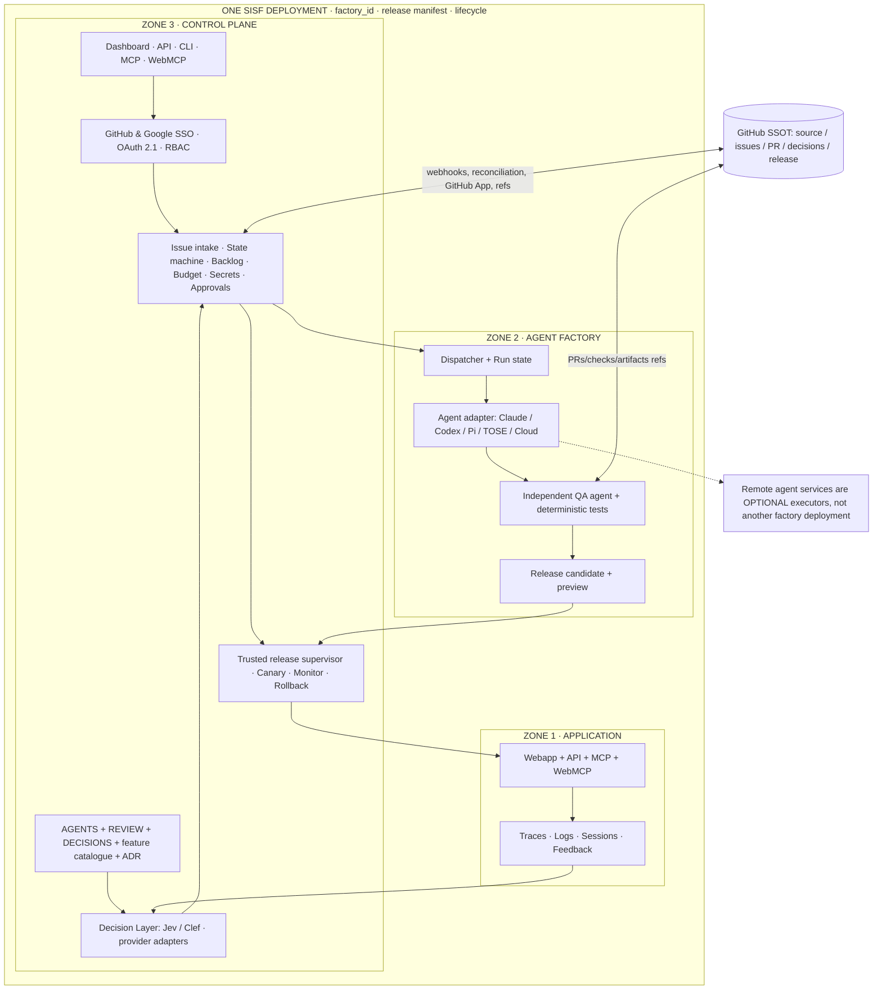
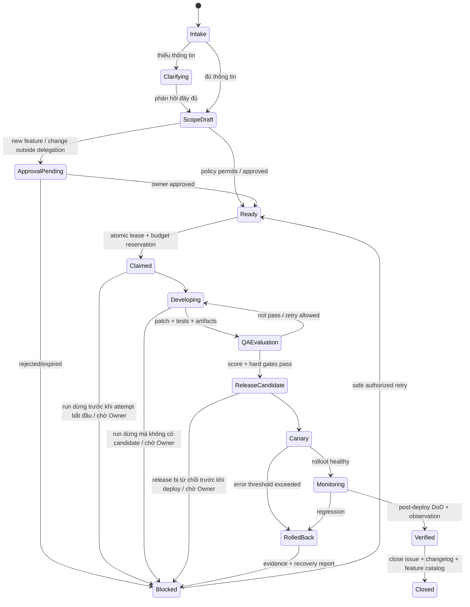

# Self-improvement Software Factory (SISF)

> **Decision brief & implementation contract**  
> Ngày: 2026-11-10 · Trạng thái: **Product decisions fixed; đã triển khai trong repository này** (phần đã được chứng minh: [README](../README.md#status) và [acceptance matrix](acceptance-matrix.md))  
> Nguồn xuất phát: `saasvn/tose-app`, HHP decision #574, kiến trúc phác thảo do Owner cung cấp.  
> Mục đích: đưa cho coding agent trong **fresh context** để triển khai theo từng lát cắt có kiểm chứng.  
> **Không** tự coi tài liệu này là quyền thay đổi production hay làm rộng quyền của agent.
> English: [self-improvement-software-factory-decision-brief.en.md](self-improvement-software-factory-decision-brief.en.md). Bản tiếng Việt là bản gốc; khi hai bản lệch nhau thì bản tiếng Việt có hiệu lực.

## 0. Tóm tắt quyết định không được thay đổi

1. **Tên sản phẩm:** `Self-improvement Software Factory` (SISF), framework mã nguồn mở. Là một *software factory* khép kín từ tiếp nhận yêu cầu đến xuất bản, giám sát, phục hồi và tự cải tiến chính hệ thống.
2. **Bất biến kiến trúc:** Zone 1 (Application), Zone 2 (Agent factory) và Zone 3 (Control plane) **phải cùng nằm trong một factory deployment**; có thể dùng nhiều process/container/service nhưng chung `factory_id`, release manifest, configuration lifecycle, gateway và authority plane. Không chia thành ba sản phẩm hay ba deployment độc lập. Một cloud agent bên ngoài chỉ là **execution backend** được Zone 2 gọi, không phải Zone 2 thay thế.
3. **Zone 1:** ứng dụng phục vụ người dùng có Webapp, API, MCP, WebMCP; tạo logs, traces, sessions, activities, feedback.
4. **Zone 2:** có built-in runtime Claude CLI, Codex CLI/app-server, Pi; cho phép adapter đến Claude Routines/Claude Cloud, Codex managed/cloud APIs, TOSE Cloud Agents, nếu API, quyền truy cập và lifecycle tương thích được kiểm chứng. Phải có dispatcher, state/worker control và QA orchestration **bên trong factory deployment**.
5. **Zone 3:** control plane sở hữu dashboard, API, CLI, MCP, WebMCP, authentication, RBAC, dashboard đồ thị, state graph, trạng thái, backlogs, approvals, traces/logs/activities/sessions, secrets, budget, feature catalogue, ADR, docs/changelog, release/rollback.
6. **GitHub SSOT:** Git là nơi có thẩm quyền với source/manifest/docs/ADR/decision policy; Issues/PRs/checks/releases thể hiện công việc, bằng chứng và quyết định. Webhooks phát sự kiện. **Không dùng GitHub thay DB giao dịch cho locks, jobs, ledger, sessions/secrets**; các bảng vận hành là trạng thái phái sinh/tác nghiệp và luôn tham chiếu SHA/issue ID/decision revision.
7. **Nền tảng triết lý:** `AGENTS.md`, `REVIEW.md`, `DECISIONS.md` (quy tắc ưu tiên và câu hỏi cho System One), `FEATURES.md` hoặc `features.yaml`, `docs/adr/` và các policy được ký/xác nhận bởi Owner. Dùng để giải thích vì sao cần cải tiến và cách đánh giá. Agent không thể sửa rule để tự qua QA.
8. **Tự triển khai Zone 1:** sau khi QA agent độc lập chấm điểm đạt **và** các deterministic gates/rollback preflight đạt; triển khai theo policy A/B/C. Có progressive rollout/canary hoặc blue-green với monitoring và **automatic rollback khi vượt ngưỡng lỗi**; nếu không thể quan sát/rollback an toàn thì không tự publish.
9. **Self-improvement of the factory:** có thể cải tiến code Zone 1/2/3 của chính factory; cập nhật bộ máy điều phối/QA/policy thuộc *trusted control surface*, yêu cầu bảo vệ đặc biệt và cơ chế updater/supervisor nguyên trạng. Không cho ứng viên mới vừa sửa tiêu chí QA vừa tự chấm điểm bản thân.
10. **Authentication:** đăng nhập GitHub hoặc Google SSO. Cả hai ánh xạ vào actor/role nội bộ; GitHub App installation là quyền đối với repo, **khác** đăng nhập GitHub của người dùng. MCP từ xa dùng cơ chế OAuth 2.1 phù hợp đặc tả; browser WebMCP không có quyền vượt backend.
11. **Ngân sách mặc định:** `unlimited` theo yêu cầu Owner; vẫn metering, hiển thị chi phí, cảnh báo và có thể cấu hình hard cap; không đồng nghĩa provider API cho phép chi vô hạn, không bao giờ dùng giá trị này để bỏ giới hạn security, concurrency, thời lượng hoặc số lần thử.
12. **Feature mới và upstream contribution:** Owner quyết định tính năng mới, mở rộng phạm vi/permissions, thay đổi policy quan trọng, gửi contribution về package gốc. Trong phạm vi đã ủy quyền, agent có thể tự cải tiến chức năng đã có. Cải tiến vẫn thuộc **một factory deployment** trừ khi Owner chủ động chia sẻ.

Mỗi bất biến ở trên có một ADR trong [docs/adr/](adr/) ghi bối cảnh, quyết định và kiểm thử chấp nhận: [0001](adr/0001-three-zones-one-deployment.md) (mục 2 đến 5), [0002](adr/0002-trust-roots-and-supervisor-boundary.md) (mục 9, phần 6.3), [0003](adr/0003-policy-precedence-and-foundation-files.md) (mục 7), [0004](adr/0004-github-ssot-and-operational-state.md) (mục 6), [0005](adr/0005-self-deploy-zone1-qa-and-rollback.md) (mục 8), [0006](adr/0006-login-vs-repo-permission.md) (mục 10), [0007](adr/0007-budget-default-unlimited.md) (mục 11), [0008](adr/0008-owner-authority-features-upstream.md) (mục 1 và 12). Phần kế thừa ở mục 11 được liệt kê trong [0009](adr/0009-tose-reuse-candidates-for-later-audit.md). Các điểm còn mở ở mục 15 là các ADR [0010](adr/0010-new-requirements-placement.md) đến [0018](adr/0018-people-during-an-incident.md), đều ở trạng thái proposed.

## 0.1 Thuật ngữ

| Thuật ngữ | Nghĩa trong tài liệu này |
|---|---|
| Owner | Người sở hữu một factory deployment; là người duy nhất được mở rộng quyền, duyệt feature mới và thay policy. |
| SoW / DoD | Scope of Work (phạm vi công việc) và Definition of Done (tiêu chí hoàn thành đo được) của một nhiệm vụ. |
| LKG | Last Known Good: bản phát hành gần nhất đã được xác minh chạy tốt, dùng làm đích rollback. |
| HHP | Hybrid Harness Platform, thiết kế nội bộ của TOSE mà SISF kế thừa ý tưởng (mục 16). |
| Policy A/B/C | Ba chế độ ủy quyền theo từng deployment, kế thừa từ HHP: **A** theo yêu cầu (agent chỉ chạy khi con người khởi động), **B** chủ động đề xuất (agent đề xuất, con người cho phép trước khi sửa hoặc phát hành), **C** tự chủ có giới hạn (thay đổi qua mọi deterministic gate không cần duyệt kỹ thuật từng lần). Hành động của Publisher như gửi contribution upstream luôn cần con người. |
| Decision Layer | Thành phần Zone 3 biến tín hiệu telemetry và feedback thành đề xuất có căn cứ. Nó chỉ khuyến nghị và phân loại, không cấp quyền. |
| System One | Lớp model quyết định trả về phán đoán có kiểu (typed) thay vì văn bản tự do, được Decision Layer gọi qua adapter. |
| Jev, Clef | Hai lựa chọn model System One cho adapter của Decision Layer; cấu hình được và ghim phiên bản. Lỗi, timeout hoặc câu trả lời sai schema thì fail closed. |
| Trusted control surface | Supervisor, khóa ký, policy enforcement, QA baseline và quy tắc rollback: phần mà một ứng viên không được tự sửa (mục 6.3). |

## 1. Mục tiêu và anti-goals

### Mục tiêu

- Một người có repository GitHub cài **một deployment SISF gồm đủ ba zone** và có hệ thống tự vận hành end-to-end; không yêu cầu TOSE.
- Hai đầu vào đều khép kín: (a) GitHub issue được gắn nhãn hợp lệ và (b) telemetry/feedback được Decision Layer chuyển thành issue/proposal có căn cứ.
- Mọi tác vụ có SoW/DoD versioned, agent worker và QA agent tách biệt, tiến độ và approvals quan sát được qua UI/API/CLI/MCP/WebMCP.
- Xuất bản Zone 1 an toàn, đo lại hậu triển khai, tự rollback; factory có đường nâng cấp chính mình với trusted updater.
- Backend thay thế được, nhưng không hứa mọi provider/platform có cùng capability.

### Không phải mục tiêu phiên đầu

- Multi-tenant SaaS, marketplace, bán licenses, đóng góp upstream tự động, hệ thống CI chung thay GitHub Actions, tự xây Git server/OCI registry/identity provider, scheduler phân tán phức tạp, hỗ trợ toàn bộ nền tảng bằng tên gọi mà chưa qua E2E.
- Tự mở tính năng mới hoặc để issue người ngoài nâng quyền triển khai.
- Đảm bảo 'unlimited' = không thể bị tính phí bởi provider.

## 2. Kiến trúc logic: một deployment, ba zone



**Triển khai chung:** một `factory.yaml` là manifest của **một factory deployment** với `factory_id`, các thành phần `application`, `agent`, `control`, kho lưu trữ, trusted release supervisor và networking; runtime có thể là nhiều container trong cùng Compose stack/Kubernetes release/Cloudflare app deployment hoặc nhiều process. Platform không bảo đảm hợp đồng này thì ghi *unsupported full deployment*; không lén chuyển Zone 2 hoặc Zone 3 thành một SaaS bắt buộc bên ngoài. Cloud agent API và GitHub là các **tích hợp** được phép.

**Vòng đời:** khởi tạo/tạm dừng/cập nhật/phục hồi/dỡ cài đặt mang tính factory deployment, nhưng mỗi zone có process/health check riêng; release manifest ghim toàn bộ artifacts/digests và tương thích schema. Khi đổi Zone 1, không tự tái cấu hình Zone 2/3 nếu không cần.

**SSOT/GitHub:** mỗi zone có nguồn và quyết định trong GitHub nhưng không có nghĩa mỗi request ở Zone 1 phải đồng bộ GitHub. GitHub ngắt thì Zone 1 tiếp tục phục vụ revision đã xác minh; ingestion/publish cần dừng hoặc xếp đợi an toàn.

## 3. Định nghĩa interface/plugin

### 3.1 AgentBackend

Khai báo capabilities trước khi dùng:

`start(task, workspaceRef, scopes) -> runRef`, `status(runRef)`, `events(runRef,cursor)`, `cancel(runRef)`, `collectArtifacts(runRef)`; tùy chọn `resume`, `checkpoint`, `usage`, `humanInput`, `sessionLink`, `webhooks`.

- Built-in: Claude CLI; Codex CLI/app-server; Pi RPC. Agent chạy trong task workspace có giới hạn filesystem/network/time.
- Remote: Claude Routines/Cloud, OpenAI Codex Agents API/Cloud khi xác nhận giao thức, TOSE Cloud Agents. Adapter trả `NOT_SUPPORTED` khi thiếu cancel/replay/usage và không được tuyên bố có hard budget nếu provider không cưỡng chế được.
- Không đưa provider token/subscription token vào logs hoặc container người dùng; chỉ credentials theo phạm vi, cấp ngắn hạn.
- **Điều phối và tính toán quyết định nằm tại Zone 2/3 cùng deployment**, kể cả agent thực thi chạy ở bên ngoài.

### 3.2 ExecutionBackend

`createSandbox`, `exec`, `files`, `snapshot`, `inspect`, `destroy`, `health`, `capabilities`. Local process (trusted single-user), Docker, Docker+gVisor, K8s, Cloudflare Sandbox, Vercel Sandbox, TOSE runtime, backend tương thích khác. Không đồng nhất *hosted provider* với *isolation guarantee*. Nếu không thể chứng minh cách ly cần thiết, không chạy code không tin cậy ở chế độ tự động.

### 3.3 DeploymentBackend

`stage(artifact)`, `preview`, `measure`, `promote`, `observedRevision`, `rollback`, `capabilities`. Bắt buộc hỗ trợ ít nhất **một phương án chuyển phiên bản an toàn có đường quay lại** trước khi tự publish. Docker/Compose và Kubernetes đầu tiên; serverless adapter theo capability matrix. Không dùng API update thành công thay cho observed healthy release.

### 3.4 Identity, State, Secret, Telemetry, GitHub

- `IdentityProvider`: GitHub OIDC/OAuth login flow và Google OIDC; *GitHub App installation* riêng cho quyền repository.
- `StateStore`: SQLite WAL cho single-host; PostgreSQL cho HA/multi-process; lock/lease/CAS, outbox, transactional budget. Migration versioned.
- `SecretProvider`: local encrypted-at-rest, env reference hoặc cloud secret manager; tuyệt đối không lưu secret plaintext trong GitHub.
- `TelemetryAdapter`: OpenTelemetry spans + logs/metrics/events normalized, privacy redaction, attribute `factory_id`, `deployment_id`, `zone`, `release_digest`, `run_id`, `issue_ref`.
- `GitHubAdapter`: signed webhooks, event dedup, polling/reconciliation, issues/comments/labels, PR/checks/releases, token rotation/revocation.

### 3.5 Chọn model và effort

Model route của mỗi run do **code** chọn theo loại bước, không để một model tự chọn. Cấu hình nằm trong `.sisf/factory.yaml`, được ghim theo policy SHA và ghi vào run record.

- **Định tuyến theo loại việc (mặc định khởi điểm):** phân loại, intake, gắn nhãn và trích xuất dùng model nhỏ nhất của provider; viết code theo SoW đã rõ dùng model tầm trung; migration, refactor lớn, quy hoạch kiến trúc và điều phối nhiều worker dùng model mạnh nhất. Subagent chỉ đọc (tìm file, đọc log, tóm tắt) dùng model nhỏ; sửa code và phán đoán ở lại model chính.
- **Thang leo khi chưa đạt, theo đúng thứ tự:** (1) bảo đảm agent tự kiểm chứng được bằng test, build hoặc script; (2) tăng effort một bậc; (3) chuyển lên model lớn hơn, bắt đầu ở effort thấp hơn mức vừa dùng.
- **Chạy rẻ trước, chạy lại phần rớt:** vì QA gate chấm tự động, run bắt đầu ở effort thấp; chỉ run rớt QA mới chạy lại ở mức cao hơn. Số lần leo có giới hạn và tính vào ngân sách của issue.
- **Chỉ đổi model ở ranh giới trạng thái:** đổi model giữa chừng làm mất prompt cache và có thể mất phần suy luận trước đó. Khi đổi, run mới nhận một bản tóm tắt có cấu trúc (SoW, DoD, quyết định, bằng chứng), không nhận nguyên lịch sử.
- **Viết request cho model khắt khe nhất:** `AgentBackend` giữ lịch sử chỉ nối thêm, dùng `tool_choice: auto` với tool có schema chặt, đọc content block theo kiểu và viết mô tả tool đủ chính xác cho model diễn giải sát chữ nhất. Nhờ đó một bước đổi tier mà không đổi code.
- **Không mặc định dùng advisor hoặc nhiều model:** chỉ giữ cấu hình nhiều model khi số đo trên việc thật cho thấy nó thắng mọi cấu hình một model về điểm so với chi phí (xem Chỉ số giá trị, mục 13).

Bảng định tuyến là tham số hiệu chỉnh, không phải quyết định cố định; tên model cụ thể thuộc cấu hình của từng deployment.

## 4. Quy tắc quyết định có căn cứ

### 4.1 Các file nền

| File | Trách nhiệm | Chỉnh sửa tự động? |
|---|---|---|
| `AGENTS.md` | Bối cảnh sản phẩm, cách làm việc, nguyên tắc kỹ thuật cho agent | Có thể đề xuất PR; không có thẩm quyền thay policy |
| `REVIEW.md` | Tiêu chí QA/release, evidence bắt buộc, review checklist | PR có Owner duyệt; agent không tự hạ ngưỡng |
| `DECISIONS.md` | Triết lý, mục tiêu, no-go, phương pháp phân loại/xếp ưu tiên của Decision Layer/System One | PR có Owner duyệt; luôn ghim SHA và schema version |
| `FEATURES.md` hoặc `features.yaml` | Chức năng đã được con người chấp thuận; định nghĩa/giới hạn hành vi | Mọi feature mới phải có Owner approval |
| `docs/adr/*.md` | Ràng buộc kiến trúc và lý do quyết định | Có lịch sử và Owner review khi thay quyết định |
| `.sisf/factory.yaml` | Khai báo 3 zone, adapter, cấu hình desired state, release policy | Owner/Git branch protection; chi phí thực tế không nằm trong file |

**Thứ tự áp dụng:** bất biến an toàn trong code + quyền ủy quyền đã xác minh > owner-approved policy/config ở SHA protected > `DECISIONS.md` / `REVIEW.md` / `FEATURES.md` / ADR > hướng dẫn thực thi `AGENTS.md` > issue/bình luận/logs. Mâu thuẫn hoặc SHA chưa được chấp thuận => hold, không để model tùy chọn luật thuận tiện hơn.

**Lưu ý:** văn bản Markdown có thể hướng dẫn model nhưng không thay cho kiểm tra deterministic. Những điều khoản cần cưỡng chế phải có schema cấu trúc/test tương ứng. Mỗi quyết định lưu `policy_sha`, `review_sha`, `decision_sha`, `feature_catalog_sha`, `model_route`, evidence IDs để audit.

### 4.2 Hợp đồng Decision Layer

Luồng: `signal → data quality + redaction → baseline / affected feature → candidate goal → typed questions → rationale + evidence → scope & policy check → task proposal`.

- Evidence gồm metric, xu hướng/baseline, số mẫu, khoảng thời gian, correlation issue/session, ảnh hưởng user, tính lặp lại, mức độ tin cậy, source refs. Không đủ dữ liệu thì chọn `collect_more_evidence` hoặc `ignore`, không ép có cải tiến.
- Analysis Agent tạo mục tiêu, phương án, SoW dự thảo và measurable DoD. Jev/Clef lựa chọn `ignore|observe|investigate|propose|implement|stop`, `bug|existing_improvement|new_feature|policy_change`, priority và các điểm chưa chắc chắn.
- `DECISIONS.md` định nghĩa câu hỏi typed cho System One và trọng số/ưu tiên; model không có quyền sửa scope, test evidence, release threshold hay ngân sách.
- Model classification chỉ làm **tăng mức thận trọng** hoặc ưu tiên; deterministic checks có quyền veto.

## 5. GitHub issue workflow (bắt buộc)

### 5.1 Đầu vào và nhãn

- `sisf:ready`: yêu cầu intake; không mặc nhiên cấp quyền thực thi. Có thể cho cấu hình ánh xạ từ nhãn hiện có (ví dụ `ai-handle`), mặc định **tắt**.
- `kind:bug`, `kind:improvement`, `kind:feature`, `kind:question`.
- `sisf:needs-info`, `sisf:approved`, `sisf:running`, `sisf:qa`, `sisf:canary`, `sisf:blocked`, `sisf:verified`; framework cập nhật các nhãn trạng thái, không dùng nhãn làm distributed lock.
- `agent:*` là sở thích định tuyến; người gắn nhãn không tự tạo quyền hoặc ngân sách. `deployment:<id>` phải được xác thực với mapping repo/installation.

### 5.2 State machine



- Mọi trạng thái ghi vào DB vận hành có `version`, `idempotency_key`, `lease_owner`, `attempt`, `run_id`, `issue_id` rồi chiếu lên GitHub. Không giả định webhook giao đúng thứ tự hay một lần duy nhất.
- GitHub webhook: verify HMAC secret, action/type, install/repo, delivery ID; lưu inbox transaction, trả 2xx nhanh, xử lý async, định kỳ reconcile và redeliver theo phạm vi có thể. Bot tự chỉnh nhãn/comment phải được chống vòng lặp.
- AI hỏi làm rõ bằng comment; issue không có phản hồi theo timeout thì chuyển `needs-info`, không tiêu tiền vô hạn.
- SoW/DoD được version hóa và đính kèm issue/PR; sửa đáng kể sau approval làm approval cũ hết hiệu lực.
- Tiến độ: một comment tổng hợp có thể cập nhật, checkpoints/PR links, trạng thái ngay trong dashboard; tránh spam từng log/token vào issue.
- `close issue` chỉ sau khi **observed deployed version** đạt DoD và qua monitor/rollback window. PR merge không tự động đồng nghĩa hoàn thành.

### 5.3 Luồng phản hồi/tính năng qua MCP/API/UI/WebMCP

`report / propose → triage / phỏng vấn → phân loại → SoW/DoD → tạo issue → thông qua approval theo loại → chạy pipeline trên`. Với feature mới: **Owner chấp thuận rõ scope** trước coding/production. Người gửi report không trở thành Owner.

### 5.4 Approval inbox

Mọi protocol có cùng `list approvals`, `get proposal + evidence + diff + affected features`, `approve/reject/request-changes`, `status/audit`. Approval chỉ chấp nhận actor có quyền, dựa trên `subject_digest`, policy revision, expiry, nonce và không được replay; hành động nhạy cảm yêu cầu step-up/verified user confirmation, **không cho một browser agent dùng ambient Owner session tự giả danh người duyệt**. Với CLI/MCP có thể khởi động device/browser verification flow, rồi nhận kết quả qua chính protocol đó.

## 6. QA, tự publish, tự rollback

### 6.1 QA độc lập

- Coding agent khác identity/workspace với QA agent. Khi deployment có từ hai model route trở lên, QA phải dùng model hoặc nhà cung cấp khác với route coding và route planning để tránh chung điểm mù; nếu chỉ có một route thì receipt ghi `same_model_route: true` và policy có thể yêu cầu Owner duyệt thay vì tự publish. QA có test baseline **read-only**, được khóa với commit và policy SHA, chạy deterministic suite + threat negative tests; có thể dùng judge model cho tiêu chí ngữ nghĩa.
- **Rubric khởi điểm cần hiệu chỉnh:** correctness/regression 30, security + auth 25, contract + data safety 20, UX/performance/output 15, observability + rollback 10. Default proposal `score >= 85/100`, không có một hard-gate failure nào; số này là **mức khởi điểm thiết kế**, không phải ngưỡng được nghiên cứu chứng minh.
- *Hard gates:* tests/contract, permissions, migrations, secrets, confidence of observed build, independent evaluator, resource/budget policy, rollback readiness. QA score cao không được override hard failure.
- Ghi `qa_receipt` ký bởi trusted evaluator: candidate digest, suite digest, baseline SHA, QA agent identity, `model_route` của cả coding agent và QA agent, checks, score, timestamp, expires, evaluator attempt.
- QA không thể chấm mã chưa xây xong hoặc mượn receipt của commit khác.

### 6.2 Release pipeline

`build immutable candidate → preview → QA → preflight rollback → canary OR blue-green → observed revision + metrics → promote/restore`.

- Có thể bắt đầu bằng **blue-green + smoke + monitor**, khi environment hỗ trợ canary traffic thì `5%→25%→100%` là **mặc định đề xuất, phải hiệu chỉnh**, không được ép platform không có traffic split.
- Auto rollback khi metric vượt `rollback_error_rate` sau `min_sample_count` trong `window` và vượt baseline có ý nghĩa; ví dụ cấu hình minh họa: 5xx > 2% và tăng > 1 điểm phần trăm so baseline, `min_samples=100`, `window=10m`, 2 cửa sổ liên tiếp. Tất cả là thông số *khởi điểm* cần đánh giá trên lưu lượng thực; critical security/health failure rollback hoặc dừng ngay. Với lưu lượng thấp, không kết luận từ 1 request lỗi; dùng smoke/synthetic + hold.
- **Chế độ lưu lượng thấp:** khi lưu lượng thực không đạt `min_sample_count` trong `window`, release chuyển sang đánh giá bằng synthetic checks bắt buộc. Synthetic suite phải phủ các luồng nêu trong DoD và chạy lặp lại suốt `low_traffic.min_hold` (ví dụ khởi điểm 30 phút, cần hiệu chỉnh). Đạt khi mọi lượt synthetic qua, health check ổn định và không có lỗi mới ở mức critical trong logs. Một lỗi từ request thật trong thời gian hold không tự kích hoạt rollback nhưng kéo dài hold và được ghi vào evidence. App không có synthetic suite thì không được tự publish ở chế độ này.
- Khi thiếu metrics/không có bản phục hồi/broken deployment adapter: `pause/hold`, không tự coi thành công.
- Rollback chỉ thay code/config tương thích; không tự ghi đè dữ liệu khách hàng bằng snapshot cũ. Cần versioned storage migrations tương thích ngược hoặc Owner approval.
- Release monitor không được cập nhật lại QA baseline bởi chính bản đang được thử nghiệm.

### 6.3 Khả năng cải tiến chính factory

- Factory source bao gồm code của cả ba zone, cho phép làm ticket/sửa lỗi của Zone 2/3, **không** giới hạn tự cải tiến vào Webapp của người dùng.
- Trusted release supervisor ở Zone 3 là tiến trình/image nhỏ, riêng và pinned, giữ LKG bên ngoài vùng sửa của ứng viên, nhưng **vẫn thuộc một factory deployment**. Không cần service ngoài factory để cứu factory.
- **Ranh giới của supervisor:** "cùng deployment" nghĩa là supervisor được khai báo trong cùng `factory.yaml`, chung `factory_id` và lifecycle cài/gỡ. "Ngoài vùng sửa của ứng viên" nghĩa là cả bốn điều sau đều đúng: (1) supervisor chạy từ image riêng ghim digest, không build từ cùng artifact với ứng viên; (2) LKG, khóa ký và cấu hình rollback nằm trên volume hoặc store mà process của Zone 1/2 và mọi agent workspace không có quyền ghi; (3) release pipeline thông thường không có quyền thay digest của supervisor, chỉ chu kỳ governance có human approval mới làm được; (4) supervisor tự kiểm tra digest của chính nó khi khởi động và từ chối chạy nếu lệch manifest đã ký. Conformance checker của P0 kiểm cả bốn điều; thiếu điều nào thì self-update bị tắt.
- Trong một lượt tự nâng cấp bản thân, candidate không được thay đồng thời trusted supervisor, signing keys, policy enforcement, QA baseline hoặc rollback rules. Những thay đổi đó là **governance change có human approval**, đi qua một chu kỳ cập nhật riêng.
- DoD phải có thử nghiệm update Zone 3 không nhạy cảm (ví dụ trang read-only dashboard), self-monitor và auto-recover; chứng minh Zone 1 vẫn phục vụ khi Zone 2/3 khởi động lại.

## 7. Authentication, authorization và secrets

- GitHub: login qua GitHub OAuth/GitHub App user auth; quyền repo qua **installation token** tối thiểu, không đánh đồng login với quyền repo. Google SSO dùng OIDC ID token, định danh theo `issuer+sub`, validate signature/iss/aud/exp/nonce; không định danh bằng email đơn thuần.
- Workspace roles: Owner, Maintainer, Reporter, Viewer, Agent, QA, Publisher/Deployment service. Mapping GitHub membership + local granted roles, kiểm tra tại thời điểm tác vụ, không dùng nhãn issue làm role.
- API phiên người dùng: session cookie HttpOnly/SameSite + CSRF cho browser; personal access/service token ngắn hạn, scopes cho API/CLI.
- Remote MCP: OAuth 2.1 + Protected Resource Metadata + resource-bound scopes, issuer/audience validation. WebMCP: chỉ khi browser hỗ trợ, bám session hiện có và chung backend auth; khi không hỗ trợ phải có API/MCP/UI fallback.
- Secrets: lưu encrypted, không gửi vào issue/PR, không để agent chạy trên mã không tin cậy đọc token GitHub App/Owner. Per-run secret broker giới hạn purpose/scope/TTL, revoke on cancel.
- Approval nhạy cảm là signed, single-use, subject/release/policy-bound, hết hạn; audit ai thực hiện (human hay agent).

### Yêu cầu bảo mật bổ sung

Các yêu cầu dưới đây bổ sung cho những quy tắc ở trên và ở mục 6.3, không thay thế quy tắc nào. Yêu cầu 1 đến 3 quyết định một agent bị thao túng gây hại được tới đâu, nên phải có trước khi factory chạy mã không tin cậy (P1 đến P2); các yêu cầu còn lại gắn với P2 đến P3. Chúng chưa được gán vào DoD của từng phase và chưa có acceptance test riêng ở mục 13.

1. **Egress của agent.** Chính sách egress do Owner quyết định và đổi được qua mọi surface (Dashboard, API, CLI, MCP, WebMCP); mỗi thay đổi đi qua `plan -> approval -> execute -> audit`, và agent không tự nới chính sách cho chính nó. Mặc định là allowlist các domain phổ biến đủ cho việc phát triển: model provider đã cấu hình, GitHub, các registry gói (npm, PyPI, crates.io, Go proxy, Maven Central), registry image (Docker Hub, GHCR) và kho gói của hệ điều hành; domain khác bị chặn và ghi log để Owner xem rồi thêm vào. Owner có thể thu hẹp, mở rộng hoặc tắt việc chặn; mở rộng và tắt hiển thị cảnh báo rủi ro. `ExecutionBackend` công bố khả năng thực thi chính sách egress trong `capabilities`; backend không thực thi được thì áp dụng quy tắc ở mục 3.2 cho mã không tin cậy.
2. **Cô lập giữa ba zone.** Mỗi zone có credential, phân vùng mạng và quyền truy cập state store riêng. Zone 1 không có đường ghi vào Zone 3 và không đọc được secret của Zone 2 hay Zone 3; Zone 2 chỉ gọi Zone 3 qua API có xác thực. Conformance checker kiểm tra các ranh giới này.
3. **Chuỗi cung ứng.** Thay đổi dependency, lockfile, base image hoặc cấu hình CI là hard gate riêng: phải pin phiên bản, qua quét lỗ hổng, và dependency mới cần Owner duyệt. Mỗi release có SBOM, provenance và artifact được ký; trusted release supervisor từ chối artifact không xác minh được chữ ký.
4. **Dữ liệu vận hành là dữ liệu không tin cậy.** Telemetry, feedback, nội dung report và PR từ bên ngoài được xử lý như issue/comment/log: chỉ là dữ liệu, không bao giờ là chỉ thị. Decision Layer không nâng quyền hay đổi policy dựa trên các nguồn này. Endpoint nhận report công khai có rate limit, giới hạn kích thước và chống trùng lặp. Việc nhận PR từ bên ngoài đi theo quyền truy cập của repo GitHub: repo public nhận PR từ fork nhưng coi là đầu vào không tin cậy (chạy trong sandbox không có secret, không có quyền ghi vào repo, và cần Maintainer chấp nhận trước khi vào pipeline); repo private chỉ nhận PR từ collaborator và agent của factory.
5. **Quản lý khóa ký.** Khóa gốc do Owner giữ ngoài factory (KMS, HSM hoặc khóa phần cứng). Factory chỉ giữ khóa ký ngắn hạn được ủy quyền từ khóa gốc, lưu trong secret store của Zone 3, và chỉ trusted release supervisor cùng dịch vụ approval dùng được; agent và candidate không đọc được khóa nào. Nhờ vậy Zone 3 bị chiếm thì Owner thu hồi khóa ủy quyền mà không phải đổi khóa gốc. Profile local native được giữ khóa gốc trong secret store của Zone 3 và phải hiển thị rõ mức bảo đảm thấp hơn này. Chu kỳ xoay vòng và quy trình thu hồi được ghi thành tài liệu; webhook secret xoay vòng được mà không mất sự kiện.
6. **Audit log chống sửa.** Audit log chỉ ghi thêm và có chuỗi băm (hoặc được sao sang nơi lưu ngoài factory), để việc xóa hay sửa bản ghi bị phát hiện. Không role nào trong factory, kể cả Owner, sửa được bản ghi đã ghi.
7. **Dữ liệu nhạy cảm trong telemetry và transcript.** Secret và dữ liệu cá nhân được che trước khi ghi vào log, transcript của agent, issue và PR. Mỗi loại dữ liệu có thời hạn lưu. Policy quy định rõ dữ liệu nào được gửi cho remote agent và model provider.
8. **Kill switch và threat model.** Owner có một lệnh dừng khẩn cấp: ngừng claim nhiệm vụ, hủy run đang chạy, thu hồi secret theo run và đóng băng publish; lệnh này không phụ thuộc vào phần factory có thể đã bị chiếm. P0 tạo `docs/threat-model.md` liệt kê tài sản, ranh giới tin cậy và kịch bản lạm dụng; mỗi kịch bản mức cao có một acceptance test.

## 8. Ngân sách và chi phí

- Mặc định **`budget.mode: unlimited`**, vẫn có usage ledger, dashboard expense/retry alerts, per-provider key controls và cancel. `unlimited` là không áp *hạn mức tiền do SISF tự đặt*, không cam kết chi phí thực tế vô hạn hoặc dùng provider miễn phí.
- **An toàn khi cài mới:** trình cài đặt hiển thị rõ mặc định `unlimited` và yêu cầu Owner xác nhận một lần, đồng thời đặt `budget.alert_threshold` hoặc chọn rõ là không đặt. Chưa xác nhận thì factory chỉ nhận intake, không claim nhiệm vụ. Vượt ngưỡng cảnh báo thì gửi thông báo, không tự dừng trừ khi Owner chọn `capped`.
- Chủ factory có thể chọn `budget.mode: capped`, reset kỳ chi/one-time, dự phòng rollback. Đồng bộ chi phí theo provider adapter; chênh lệch/usage chưa đo được hiển thị `unverified`, không thổi phồng guarantee.
- Dù unlimited tiền, mọi task có timeout, max attempts, concurrency, cancellation, rate limit và resource quotas để chống vòng lặp. Không tự nâng role/scope.
- Khi người dùng đặt hard cap, giữ chỗ trước khi bắt đầu; side effects phải idempotent và chi phí vượt dự toán được phản ánh/suspend. Factory local không thể cưỡng chế nhà cung cấp model nếu provider không có hard limit: báo mức bảo đảm công khai.

## 9. Dashboard và giao diện công cụ

### Trang tối thiểu

- **Overview:** sức khỏe ba zone, revision chạy, chiến lược canary, error rate, throughput, chi phí, nút stop/rollback.
- **Workboard:** backlog/issue list, trạng thái và owner/agent, SLA/age, live progress, retry, session link.
- **Run graph:** DAG/state graph cho từng nhiệm vụ, thời gian, tool events, decision receipts và QA evidence.
- **Telemetry:** traces/logs/activities/sessions đã lọc, tìm theo release, issue, run, feature.
- **Approvals:** yêu cầu, impact, diff, SoW/DoD, quyết định, lý do, audit.
- **Product:** feature catalogue, changelog, docs/guides, ADR, DECISIONS.md history.
- **Security & finance:** user roles, agent capabilities, secret refs, budget unlimited/capped, usage breakdown, SSO/GitHub App installations.

### Một service layer, nhiều protocol

- REST/OpenAPI là hợp đồng backend nội bộ; CLI, Dashboard, MCP và WebMCP gọi cùng policy/action service, không tự định nghĩa quyền độc lập.
- Truy vấn: `factory.status`, `issues.list`, `runs.inspect`, `approvals.list`, `approvals.decide`, `secrets.list_refs`, `budget.get/set`, `decisions.propose_update`, `docs.list`, `features.list`, `changelog.list`, `deployments.rollback` (scopes khác nhau).
- Write nhạy cảm qua `plan -> approval -> execute -> audit`, có human reauthentication/step-up theo loại quyền; **không cấp permission qua câu mô tả tool**.
- WebMCP là client-side tool surface tùy chọn, không thay thế remote MCP; kế hoạch hỗ trợ browser feature detection và fallback.

### Yêu cầu trải nghiệm: agent, người dùng, nhà phát triển

Các yêu cầu dưới đây áp dụng khi surface tương ứng được xây (P1 đến P3) và không mở rộng quyền của bất kỳ surface nào.

**Agent dùng factory (AX)**

- Mọi action trả về mã lỗi có kiểu và `next_actions`, để agent biết bước hợp lệ kế tiếp mà không phải đoán.
- Mọi lệnh ghi hỗ trợ `dry_run`, trả về đúng những gì sẽ thay đổi; lệnh nhạy cảm vẫn đi qua `plan -> approval -> execute -> audit`.
- Action `runs.explain` trả lời vì sao một run đang dừng hoặc bị chặn, kèm bằng chứng và trạng thái hiện tại.
- `llms.txt` và schema của các action được sinh từ cùng một nguồn với OpenAPI.

**Owner và Reporter (UX)**

- Approval inbox hiển thị một câu tóm tắt rủi ro, diff dự kiến, feature bị ảnh hưởng, và cho phép duyệt có điều kiện (giới hạn ngân sách, hạn dùng).
- Mỗi issue chỉ có một comment tiến độ được cập nhật tại chỗ; hệ thống không đăng comment mới cho mỗi lần đổi trạng thái.
- Cài đặt lần đầu là một wizard kiểm tra từng bước (GitHub App, SSO, budget) và kết thúc bằng một issue mẫu chạy hết vòng đời.
- Trạng thái `Blocked` có trang giải thích viết cho người đọc, kèm hành động kế tiếp.

**Người cài và người viết plugin (DX)**

- `sisf doctor` kiểm tra đủ ba zone, quyền GitHub, state store và khả năng rollback trước khi chạy thật.
- Bộ conformance test đóng gói riêng cho từng interface ở mục 3, để người viết backend tự chấm.
- Chế độ mô phỏng cục bộ với GitHub giả và agent giả chạy hết vòng đời issue mà không tốn token.
- `.sisf/factory.yaml` có JSON Schema công bố để editor gợi ý và báo lỗi sớm.

## 10. Deployment portability: compliance classes

**Bất biến:** không platform adapter nào được tự ý chia một SISF deployment thành ba application deployment độc lập; phải chung factory release manifest và lifecycle. Các dịch vụ hạ tầng thuê ngoài (GitHub, IdP, DB/object store, remote coding backend) là dependencies, không phải một zone mới.

| Profile | Cách đóng gói | Kết luận hỗ trợ |
|---|---|---|
| local native | app + dispatcher/worker + control plane trong một supervised local install, state SQLite | MVP; chỉ dùng code tin cậy nếu thiếu sandbox |
| Docker Compose | một compose project, zone service tách container + DB/volume, pin image digests | **MVP bắt buộc**; gVisor tùy chọn khi host hỗ trợ |
| Kubernetes | một Helm release/namespace ownership, app/development runner/control + persistent store/rollback | giai đoạn tiếp; security E2E bắt buộc |
| TOSE | một factory deployment với TOSE storage/runtime/budget adapters | giai đoạn tiếp, không phụ thuộc bắt buộc |
| Cloudflare | Workers + container/sandbox/DO bindings dưới một factory application deployment có đủ zone | chỉ đánh dấu đạt sau E2E; Workers thuần không thay shell runner |
| Vercel | App/API + agent dispatcher/job control + Vercel Sandbox và persistent state trong cùng logical factory installation | chỉ đánh dấu đạt sau E2E và timeout/recovery proof |
| Render / Railway | service group/containers + persistent state dưới một factory installation manifest | sau E2E; không mặc định sandbox hardening |

Nếu nhà cung cấp không thể đáp ứng `single_factory_deployment`, `durable_tasks`, `safe_exec`, `releasable_zone1`, `rollback` thì profile ở trạng thái **experimental/unsupported**, không viết “deploy anywhere” với full capability.

### Thiết kế triển khai: các đơn vị chạy

Một factory deployment gồm chín đơn vị chạy. Tên đơn vị giống nhau trên mọi nền tảng; chỉ cách hiện thực (process, container, pod, function) thay đổi. Release manifest ghim digest của mọi đơn vị.

| Đơn vị | Zone | Vòng đời | Vai trò và ràng buộc |
|---|---|---|---|
| `app` | 1 | chạy liên tục, có revision stable và canary | Nhận traffic của người dùng; scale ngang. |
| `control` | 3 | chạy liên tục | Dashboard, API, MCP, nhận webhook. Mặc định không công khai, trừ đường webhook và endpoint report. |
| `supervisor` | 3 | chạy liên tục, tách tiến trình khỏi `control` | Trusted release supervisor. Đơn vị duy nhất giữ quyền deploy và khóa ký ủy quyền. |
| `dispatcher` | 2 | chạy liên tục, một bản giữ lease | Claim nhiệm vụ, giữ run state, tạo và hủy runner. |
| `runner` | 2 | tạm thời, một cái cho mỗi run | Chạy coding agent. Không nhận kết nối vào, egress theo policy, chỉ có secret của run đó. |
| `qa-runner` | 2 | tạm thời | Chạy QA độc lập, có danh tính và credential khác `runner`. |
| `state` | dùng chung | bền | SQLite WAL hoặc PostgreSQL; mỗi zone một role riêng. |
| `artifacts` | dùng chung | bền | Volume hoặc object store cho artifact, log, snapshot. |
| `edge` | dùng chung | chạy liên tục | Reverse proxy và TLS; chia traffic giữa stable và canary. |

Mạng chia thành bốn phân vùng: `app`, `factory`, `control` và `sandbox`. Runner nằm trong `sandbox` và chỉ ra ngoài qua egress proxy thực thi policy ở mục 7.

### Hình thức vận hành

Bảng dưới là thiết kế đích của từng hình thức; trạng thái hỗ trợ vẫn theo bảng compliance ở trên và chỉ được nâng sau E2E. Tên dịch vụ của nền tảng bên thứ ba phải được xác minh lại với tài liệu hiện hành khi viết adapter.

| Hình thức | `app`, `control`, `supervisor`, `dispatcher` | `runner`, `qa-runner` | `state`, `artifacts` | `edge` và truy cập |
|---|---|---|---|---|
| Standalone | Các process trên một máy, do `sisf` giám sát qua systemd hoặc launchd | Process cục bộ (chỉ mã tin cậy), hoặc container nếu máy có Docker | SQLite WAL và thư mục cục bộ | Trực tiếp, Tailscale hoặc tunnel (xem dưới) |
| Docker | Một compose project (stack), mỗi đơn vị một service, image ghim digest | Container tạm thời trên network `sandbox`, tạo qua socket proxy giới hạn API; gVisor tùy chọn | PostgreSQL và named volume | Service reverse proxy trong stack |
| Kubernetes | Một Helm release trong một namespace; mỗi đơn vị một Deployment; canary là Deployment thứ hai có trọng số | Job, mỗi run một pod; ServiceAccount không gắn token, NetworkPolicy chặn mặc định, RuntimeClass cách ly nếu cluster có | StatefulSet hoặc PostgreSQL ngoài; PVC hoặc object store | Ingress hoặc Gateway |
| Vercel | `app` và `control` là project chạy function; `dispatcher` và `supervisor` là workflow bền hoặc queue, vì không có process chạy mãi | Vercel Sandbox | PostgreSQL và object store bên ngoài | Edge của nền tảng; canary bằng cơ chế phát hành theo tỷ lệ |
| Cloudflare | `app` và `control` là Workers; `dispatcher` và `supervisor` là Durable Objects hoặc Workflows | Container hoặc Sandbox của nền tảng | D1 hoặc PostgreSQL ngoài; R2 | Edge của nền tảng; canary bằng gradual deployment |
| TOSE (tose.sh, `saasvn/tose-app`) | Các app trong một workspace, build từ Git, có domain và TLS | TOSE runtime qua `ExecutionBackend` | Database quản lý có đĩa bền | Domain của nền tảng |
| Railway | Các service trong một project, nối qua private network | Remote executor, hoặc chỉ mã tin cậy, vì nền tảng không có sandbox lồng nhau | PostgreSQL và volume của nền tảng | Domain của nền tảng |

**Standalone có ba cách truy cập.** Trực tiếp: `control` chỉ nghe trên localhost, hoặc đặt sau reverse proxy có TLS khi mở ra mạng. Tailscale: `control` chỉ nghe trong tailnet; danh tính thiết bị của tailnet là lớp bổ sung và không thay SSO hay RBAC. Tunnel: chỉ mở `app` và đường webhook ra ngoài. GitHub webhook cần một endpoint công khai; khi không có, factory chạy ở chế độ polling kết hợp reconciliation và công bố độ trễ đó.

**Ràng buộc theo hình thức.**

- Docker: không mount Docker socket trực tiếp vào `dispatcher`, vì socket tương đương quyền root trên host. Dùng socket proxy chỉ cho phép tạo và hủy container trên network `sandbox`, hoặc Docker rootless.
- Kubernetes: `supervisor` chỉ có RBAC trong namespace của factory. Factory không cần quyền cluster-admin.
- Vercel và Cloudflare: function có giới hạn thời gian chạy, nên mỗi run chia thành các bước có checkpoint và tiếp tục được sau khi bị ngắt.
- Nền tảng tính phí trả trước: adapter kiểm tra số dư đủ cho một lần rollback trước khi publish; không đủ thì giữ ở `Releasing`.
- Mọi hình thức: nếu `supervisor` không thể tách khỏi candidate (cùng process, cùng credential) thì hình thức đó không được tự publish.

## 11. Repository layout khuyến nghị

```text
sisf/                                      # OSS repo: github.com/bestagentkits/sisf
  cmd/sisf/                                # CLI
  cmd/factoryd/                           # Zone 3 server, dispatcher
  internal/ or pkg/core/                  # clean policy & decision contracts, no TOSE imports
  pkg/identity/ pkg/state/ pkg/github/
  pkg/agent/ pkg/execution/ pkg/deploy/
  pkg/qa/ pkg/telemetry/ pkg/approvals/
  adapters/agent/{claude,codex,pi,tose,claude-cloud,codex-cloud}/
  adapters/exec/{local,docker,kubernetes,cloudflare,vercel,tose}/
  adapters/deploy/{compose,kubernetes,tose,cloudflare,vercel,render,railway}/
  ui/                                      # Dashboard + optional WebMCP
  templates/                               # three-zone full deployment manifests
  examples/                                # hello-app, app-with-existing-repo
  docs/adr/ docs/guides/ docs/security/
  .sisf/                                   # example instance policy/config
  AGENTS.md REVIEW.md DECISIONS.md FEATURES.md
  LICENSE NOTICE SECURITY.md CONTRIBUTING.md
```

**Kế thừa:** ứng viên tái sử dụng từ `saasvn/tose-app/internal/harnessplatform` gồm `delegation`, `decision`, `scope`, `budget`, `promotion`, `upstream`. Phải loại `tose-v2/internal/policy`, TOSE OAuth/wallet/K8s binding và xác minh provenance/license trước khi public. `internal/services/piadapter` hiện gắn chặt vào K8s/agentsec; chỉ tái sử dụng contract và phần adapter giao thức, không mang cả TOSE agent service sang OSS. Giữ nguyên vận hành TOSE hiện tại trong lúc trích xuất.

**Giấy phép:** Apache-2.0, Owner đã chốt ngày 2026-11-10 (`LICENSE` và `NOTICE`, bản quyền AgentKit.best). Giấy phép này áp dụng cho mã và tài liệu viết mới trong repo; mã trích từ TOSE chỉ được đưa vào sau khi audit provenance và dependencies, tài liệu này không tự cấp phép mã nguồn cũ.

## 12. SoW và thứ tự triển khai (fixed scope cho coding agent)

### P0: ADR + kiến trúc bất biến + khảo sát quyền tái sử dụng

**Trong phạm vi:** tách các bất biến ở mục 0 thành ADR riêng trong `docs/adr/` (three-zones-one-deployment, trust roots và ranh giới supervisor, policy precedence, GitHub SSOT) và để tài liệu này trỏ tới chúng thay vì lặp lại; duy trì bản tiếng Anh của brief song song với bản tiếng Việt; license/provenance; interface contracts; kịch bản test single-deployment; đánh dấu adapter capability matrix.

**DoD:** tài liệu + tests/conformance checker từ chối cấu hình thiếu zone hoặc supervisor không đạt ranh giới ở mục 6.3; mỗi bất biến ở mục 0 có một ADR; bản EN và VI của brief khớp nhau; tách được danh tính factory/runtime IDs; không thay production TOSE; owner chấp thuận thay đổi API/format.

### P1: Bản chạy ba zone local/Compose + GitHub workflow

**Trong phạm vi:** một manifest dựng ứng dụng mẫu Zone 1 + dispatcher/agent zone 2 + control plane zone 3, SQLite durable state, GitHub App/webhook/poll, nhận issue và đồng bộ state, SoW/DoD/clarify comment, worker lease/idempotency, dashboard tối thiểu, stop/restart.

**DoD:** cài từ fresh clone bằng một entrypoint; health đủ 3 zone; issue có nhãn đi qua clarification đến claimed, duplicate/reordered webhook không chạy trùng; kill worker và restart vẫn resume/reconcile; trình duyệt và API xem cùng trạng thái.

### P2: Built-in agents + QA + phát hành có rollback

**Trong phạm vi:** hai built-in agent adapter thực đầu tiên, đề xuất Claude CLI và Codex; Pi là adapter built-in thứ ba trước khi tuyên bố v1 hoàn thiện; QA độc lập, baseline & typed QA receipts, preview, blue-green hoặc canary, observed revision, metrics threshold, automatic rollback, issue close sau verification; chứng minh factory tự cập nhật phần Zone 3 không nhạy cảm; **một lát mỏng của Decision Layer**: một loại tín hiệu telemetry thật của Zone 1 (ví dụ error rate theo endpoint) đi hết luồng ở mục 4.2 và sinh ra proposal có evidence, chưa cần Jev/Clef, phân loại bằng quy tắc deterministic là đủ.

**DoD:** agent A làm patch, agent B QA, score và hard gates xác minh, triển khai Zone 1, inject lỗi khiến rollback tự động, issue mở lại/blocked với evidence; một self-update của factory và rollback được kiểm thử trên cùng deployment; tín hiệu telemetry có đủ mẫu tạo đúng một proposal kèm evidence, tín hiệu thiếu mẫu cho kết quả `ignore` hoặc `collect_more_evidence` và không tạo issue.

### P3: Auth/surfaces/Decision Layer/observability hoàn chỉnh

**Trong phạm vi:** GitHub/Google SSO; role/grant; dashboard đầy đủ; API/OpenAPI, CLI, remote MCP OAuth 2.1, WebMCP feature-detected; `DECISIONS.md` với typed model adapter Jev/Clef, mở rộng lát Decision Layer của P2 thành telemetry-driven goal proposals đầy đủ, feature catalog/changelog/docs/ADR, approvals cross-surface, secrets, budgets default unlimited và tùy chọn capped.

**DoD:** cùng quyền và hành vi trên 5 surfaces; login 2 IdP và cross-role/cross-repo tests; Decision Layer đưa ra đề xuất có dẫn chứng và chọn do-nothing khi thiếu bằng chứng; Owner duyệt feature từ bất kỳ surface nào nhưng final human verification không thể bị agent bypass; budget measured và stop honored.

### P4: Remote agents + portability/benchmark + OSS release

**Trong phạm vi:** Pi (nếu chưa), Claude Cloud/Routines, Codex managed Agents API/Cloud, TOSE Cloud Agents dưới feature flags; provider capability validation, Kubernetes, TOSE và nền tảng serverless lần lượt; threat review, performance, privacy, licensing, documentation, example recipes.

**DoD:** ít nhất 2 môi trường triển khai đầy đủ độc lập (Compose + một nền tảng khác), 2 agent khác nhau xử lý cùng contract, failed/slow/unavailable provider không làm factory đánh dấu thành công; conformance matrix public; có hướng dẫn EN/VI; quyết định GO/MODIFY/STOP dựa trên số liệu.

### Ngoài phạm vi v1 mặc dù thuộc roadmap

- Tuyên bố full support tất cả host trước E2E.
- Tự phát hành phiên bản sửa trust root, auth provider, policy evaluator hoặc rollback supervisor mà không có human approval.
- Public multi-tenant billing/marketplace hoặc network Git server thay GitHub.

### Đề xuất chờ Owner duyệt: thứ tự giao của v1

> **Chưa có hiệu lực.** Mục này không thay đổi quyết định nào ở mục 0 và coding agent không được coi nó là phạm vi đã duyệt. Nó chỉ đề xuất đổi **thứ tự giao**, không bỏ tính năng.

- **Đề xuất:** gọi P0–P2 là v1 và phát hành công khai ngay sau P2, với Docker Compose, CLI và dashboard chỉ đọc. Remote MCP, WebMCP, Google SSO và các profile serverless vẫn là quyết định sản phẩm, nhưng giao sau v1 theo P3–P4.
- **Lý do:** P3 hiện gom 5 surfaces, 2 IdP, Decision Layer đầy đủ, secrets và budgets, tương đương một sản phẩm riêng. Phát hành sau P2 cho phép đo các chỉ số giá trị ở mục 13 trên người dùng thật trước khi đầu tư phần còn lại.
- **Đánh đổi:** v1 chỉ có đăng nhập GitHub và chưa điều khiển được qua MCP; ai cần Google SSO hoặc agent điều khiển từ xa phải chờ.
- **Cách duyệt:** Owner chấp thuận bằng một ADR; khi đó mục này chuyển thành phạm vi chính thức và P4 không còn là điều kiện của bản phát hành OSS đầu tiên.

## 13. DoD hệ thống tổng thể (acceptance matrix)

| ID | Test có thể lặp lại | Pass criteria |
|---|---|---|
| SISF-01 | Fresh install Local/Compose | Đúng 1 `factory_id`, đủ Zone 1/2/3 cùng deployment manifest và chung lifecycle |
| SISF-02 | Issue có nhãn hợp lệ | Intake → clarification comment → SoW/DoD versioned → claim → coding → independent QA → deploy → verify → close; mọi mốc xuất hiện trên GitHub và UI |
| SISF-03 | Issue user ngoài quyền / feature chưa duyệt | Không triển khai/mở rộng quyền; feature mới vào approval inbox và yêu cầu Owner decision |
| SISF-04 | Hai sự kiện webhook trùng + reorder | Đúng 1 run có quyền claim, không chi trùng; reconciliation khôi phục sự kiện bỏ lỡ |
| SISF-05 | Worker chết giữa task | Khôi phục từ state/lease; fencing chặn báo cáo cũ; không mất SoW, PR hoặc artifact đã lưu |
| SISF-06 | QA agent tự chấm patch của mình | Bị từ chối; QA receipt pinned với candidate SHA và test baseline độc lập |
| SISF-07 | QA score đạt nhưng security/contract fail | Không publish bất kể score |
| SISF-08 | QA đạt + health tốt | Zone 1 lên đúng digest; kiểm tra observed revision; cập nhật changelog/feature catalogue đúng quyền |
| SISF-09 | Error rate vượt ngưỡng khi canary/monitor | Restore LKG tự động; log evidence + issue chưa close hoặc reopen; dữ liệu khách hàng nguyên vẹn |
| SISF-10 | Factory tự sửa một phần Zone 3 không nhạy cảm | QA + phát hành/rollback trong cùng factory deployment, supervisor không bị candidate thay thế |
| SISF-11 | `DECISIONS.md` đổi qua PR của agent không duyệt | Policy baseline cũ tiếp tục có hiệu lực; Decision Layer không có quyền thay tiêu chuẩn |
| SISF-12 | GitHub/Google SSO & OAuth | issuer/sub/audience, session, scopes, repo install mapping, approval step-up, revoke, CSRF negative tests đạt |
| SISF-13 | API/CLI/MCP/WebMCP/Dashboard | Cùng action service, phân quyền tương đương; WebMCP thiếu hỗ trợ vẫn có fallback |
| SISF-14 | Budget default unlimited/capped | Unlimited là default rõ ràng và Owner đã xác nhận lúc cài; cảnh báo phát khi vượt `alert_threshold`; chi phí được ghi nhận; capped reserve & stop, provider không hỗ trợ hard cap được đánh dấu |
| SISF-15 | Hai factory deployments cùng upstream | Cải tiến cục bộ A không đổi B hoặc upstream; contribution cần người dùng kích hoạt |
| SISF-16 | Chạy trên backend mới | Conformance matrix đủ lifecycle/isolation/rollback/observability; nếu thiếu thì đánh dấu unsupported |
| SISF-17 | No-activity / no-benefit telemetry | Không tạo issue vô hạn; có `ignore`/`observe`/`stop` đúng triết lý sản phẩm |
| SISF-18 | Fresh agent không có lịch sử chat | Đọc policy + SoW/DoD + repo; tái dựng context và hoàn tất công việc, không cần chat cũ |
| SISF-19 | Secrets + GitHub issue chứa prompt injection | Không vượt quyền, không lộ token, không tự thay QA/policy, không gọi domain egress cấm |
| SISF-20 | Release thiếu metrics hoặc khả năng rollback | Hold/blocked, không tự publish trên mô hình giả định thành công |

**Release GO** chỉ khi không có High/Critical security issue chưa xử lý, có báo cáo E2E thật và phần nào ghi experimental được đánh dấu trung thực. **Dừng/MODIFY** nếu không chứng minh một deployment 3 zone, nếu factory mất khả năng phục hồi, nếu agent tự cấp quyền, nếu tự close issue chưa đạt DoD, hoặc nếu không tạo giá trị hơn workflow GitHub+agents đơn giản.

### Chỉ số giá trị

Điều kiện "tạo giá trị hơn workflow GitHub+agents đơn giản" được đo bằng cách chạy cùng một tập issue qua hai đường: SISF và một baseline gồm GitHub Actions gọi một coding agent rồi con người review và merge. Thu thập từ P2 trở đi, trên ít nhất một repo thật:

| Chỉ số | Cách đo | SISF phải |
|---|---|---|
| Tỷ lệ issue hoàn tất không cần người can thiệp | Issue đạt `Verified` mà không có thao tác thủ công ngoài approval bắt buộc, chia tổng issue đã claim | Cao hơn baseline |
| Tỷ lệ thay đổi lỗi | Release bị rollback hoặc issue bị reopen trong cửa sổ quan sát, chia tổng release | Không cao hơn baseline |
| Thời gian từ issue đến verified | Trung vị từ `Ready` đến `Verified` | Không chậm hơn baseline quá mức Owner chấp nhận |
| Chi phí mỗi issue verified | Chi phí model và hạ tầng từ usage ledger, chia số issue `Verified` | Được báo cáo; Owner quyết định mức chấp nhận |
| Tỷ lệ proposal hữu ích | Proposal từ Decision Layer được Owner chấp thuận, chia tổng proposal | Được báo cáo; quá thấp là tín hiệu STOP cho Decision Layer |
| Chi phí theo model route | Chi phí mỗi issue `Verified` tách theo model và effort của từng bước, lấy từ usage ledger | Được báo cáo; cấu hình nhiều model chỉ được giữ khi thắng mọi cấu hình một model |

Ngưỡng cụ thể do Owner đặt sau khi có số liệu baseline đầu tiên; quyết định GO/MODIFY/STOP ở P4 phải trích các chỉ số này.

## 14. Implementation instructions for the coding agent

1. **Không tự đảo ngược bất biến sản phẩm**. Nếu thấy 3 zone nằm trên 3 deployment riêng, xem đó là lỗi thiết kế; đề xuất phương án hoặc fail capability gate.
2. Bắt đầu bằng repo/ADR read-only và dependency & license audit; xác nhận source snapshot. Không cho rằng HHP pure policy core đã có API/worker chạy thực tế.
3. Tạo **smallest vertical slice**, commit từng bước; tests phải đỏ trước mỗi hành vi, negative tests cho bảo mật/chi tiền.
4. Giữ backward compatibility nếu tách code từ TOSE: chuyển qua adapter, không sửa logic sản xuất TOSE chỉ để thuận tiện trích xuất.
5. Mỗi bước trả: công việc làm, thay đổi file/commit, kết quả test, rủi ro mới, DoD nào đạt/chưa đạt và blocker. Không hứa đã deploy khi chỉ có unit test.
6. Không tạo issue hay thêm `ai-handle` nếu chưa được Owner ủy quyền riêng. Không chạm production, không rotate secrets hoặc cấp quyền dựa trên tài liệu này.
7. Trước khi mở PR, đối chiếu lại policy/manifest/DoD đã được Owner ký với commit hiện tại; nếu có xung đột thì báo chứ không tự sửa quyết định.

## 15. Những quyết định đã chốt và điểm cần xác minh kỹ thuật

### Đã chốt (không phỏng vấn lại)

- Tên SISF, 3 zone cùng deployment, Zone2 linh hoạt, GitHub SSOT, input GitHub issue/telemetry, SoW/DoD + QA + auto publish Zone1 + rollback, dashboard/5 surfaces, GitHub/Google SSO, ngân sách unlimited mặc định, triết lý AGENTS/REVIEW/DECISIONS, tự cải tiến chính mình, feature mới/contribution thuộc Owner.

### Các tham số kỹ thuật mặc định để thử nghiệm, **được hiệu chỉnh theo benchmark**

- QA score khởi điểm 85/100 **cộng** hard gates; canary 5→25→100 khi platform hỗ trợ; threshold lỗi ví dụ 5xx>2% và delta>1pp với đủ mẫu. Không áp dụng máy móc cho app không có HTTP request hoặc lưu lượng thấp.
- Local SQLite WAL, multi-worker Postgres; Compose là full-deployment profile đầu tiên; 2 built-in agents đầu tiên Claude CLI + Codex, tiếp Pi. Có thể thay nếu proof chỉ ra adapter khác khả thi hơn mà vẫn đủ hai backend.
- GitHub App OAuth cho repository workflow, OIDC Google cho SSO, role mapping cần rõ. Repo OSS là `bestagentkits/sisf`, giấy phép Apache-2.0 (đã chốt); mã kế thừa từ TOSE vẫn phải qua audit quyền sở hữu trước khi đưa vào.

### Điểm còn mở, chờ Owner quyết

> **Chưa có hiệu lực.** Các điểm dưới đây là khoảng trống đã biết, không phải yêu cầu. Coding agent không tự quyết thay Owner; mỗi điểm được đóng bằng một ADR, ghi rõ là yêu cầu (kèm phase và acceptance test) hoặc là non-goal có chủ đích.

1. **Yêu cầu mới chưa có chỗ trong SoW.** Mục 3.5, yêu cầu trải nghiệm ở mục 9, yêu cầu bảo mật bổ sung ở mục 7 và thiết kế triển khai ở mục 10 chưa được gán vào DoD của P0 đến P4 và chưa có test SISF-xx. Cần quyết: mỗi yêu cầu thuộc phase nào và test nào chứng minh nó.
2. **Phạm vi v1.** Đề xuất đổi thứ tự giao ở mục 12 vẫn chờ duyệt, trong khi phạm vi đã tăng thêm. Cần quyết trước khi bắt đầu P0.
3. **Sao lưu và khôi phục.** Chưa có quy định về backup `state` và `artifacts`, mục tiêu RPO và RTO, và cách dựng lại factory từ GitHub khi mất database.
4. **Migration schema khi factory tự cập nhật.** Rollback code đã có quy tắc; rollback sau khi schema database đã đổi thì chưa. Cần quyết: chỉ cho phép migration tương thích ngược, hay có bước khôi phục dữ liệu.
5. **Nhiều repo và nhiều app.** Chưa rõ một factory phục vụ một repo hay nhiều repo, và nếu nhiều thì các repo có chung policy, budget và secret hay không.
6. **Giới hạn của nhà cung cấp.** Chưa có cách xử lý rate limit của GitHub API và model provider khi nhiều run chạy song song, và hành vi của factory khi một provider ngừng hoạt động.
7. **Quản trị dự án OSS.** Chưa có `CONTRIBUTING.md`, quy tắc đóng góp (DCO hoặc CLA), cách đánh version và cam kết tương thích cho các interface ở mục 3.
8. **Pháp lý và dữ liệu.** Chưa nói về giấy phép của code do agent sinh ra, dữ liệu người dùng được gửi tới model provider, và nơi lưu dữ liệu theo vùng.
9. **Con người khi có sự cố.** Chưa có kênh thông báo ngoài GitHub, người trực, và quy trình khi auto-rollback cũng thất bại.

## 16. Evidence & nguồn nghiên cứu

- TOSE HHP current design: https://github.com/saasvn/tose-app/blob/899851ae84ead1177b8d12356ce4c262cb8ffac0/docs/harness-platform.md ; issue #574: https://github.com/saasvn/tose-app/issues/574 ; PR #622: https://github.com/saasvn/tose-app/pull/622 .
- GitHub webhooks: https://docs.github.com/en/webhooks/using-webhooks/best-practices-for-using-webhooks
- GitHub App vs OAuth app: https://docs.github.com/en/apps/oauth-apps/building-oauth-apps/differences-between-github-apps-and-oauth-apps
- MCP authorization: https://modelcontextprotocol.io/specification/2026-07-28/basic/authorization
- WebMCP draft (not W3C standard): https://webmachinelearning.github.io/webmcp/
- Claude Routines API trigger, experimental and non-idempotent: https://platform.claude.com/docs/en/api/claude-code/routines-fire
- OpenAI Agents API (managed Codex harness): https://developers.openai.com/api/docs/guides/agents-api/overview
- Cloudflare Sandbox: https://developers.cloudflare.com/agents/tools/sandbox/
- Vercel Sandbox: https://vercel.com/docs/sandbox
- Progressive rollout/metric analysis (reference design): https://argoproj.github.io/argo-rollouts/features/analysis/
- Google OIDC: https://developers.google.com/identity/openid-connect/openid-connect
- Anthropic, "Which Claude model should you build with?" (2026-11-09), nguồn cho mục 3.5: https://claude.dev/blog/which-claude-model-should-you-build-with/

**Source status:** TOSE repository is source-derived as inspected; external platform capabilities are based on their published docs; thresholds, proposed interfaces, schema, licensing and staged SoW/DoD are **design recommendations**, not implemented facts.
